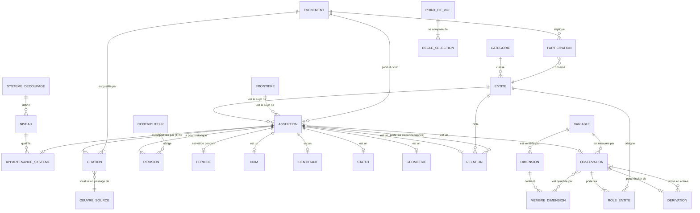
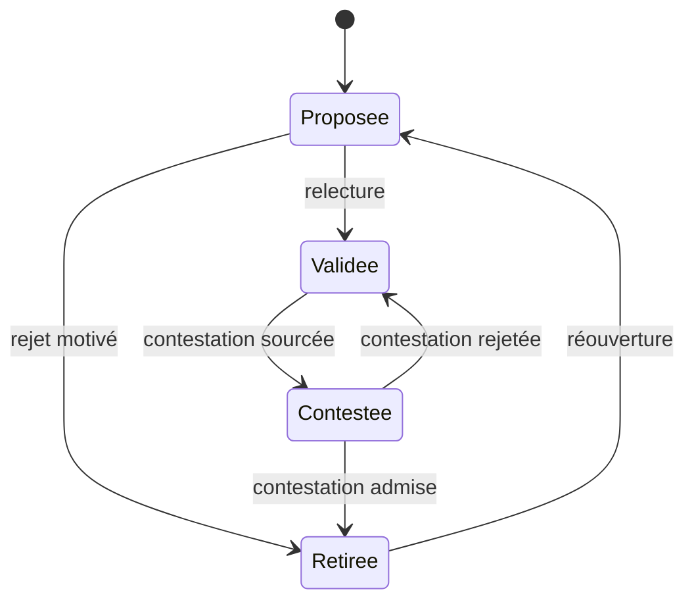
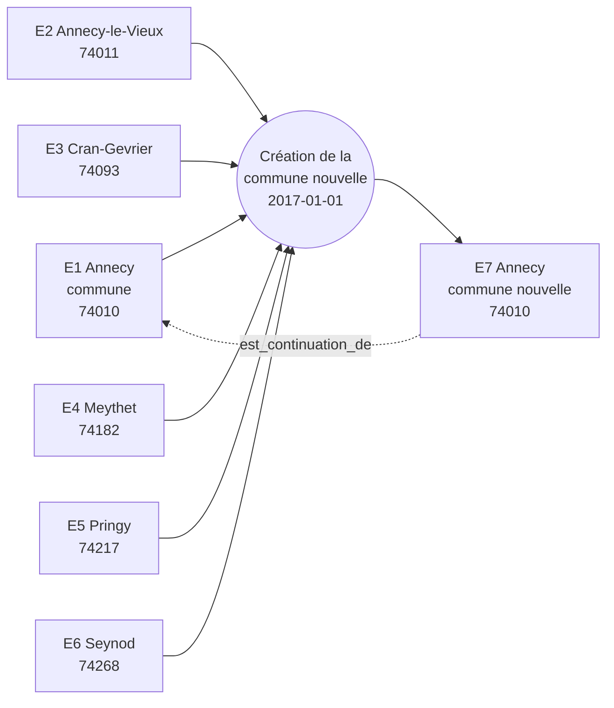
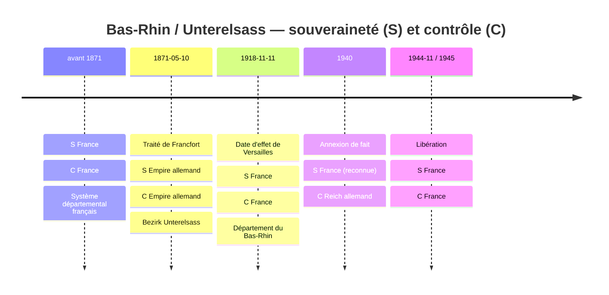

# Modèle de données conceptuel de l'atlas

> **Statut** : proposition, version 1 (octobre 2026).
> **Portée** : modèle **conceptuel** uniquement. Ce document ne retient aucune technologie de stockage, aucun format d'échange ni aucune bibliothèque. Les termes « entité », « attribut » et « relation » s'entendent au sens conceptuel.

---

## 1. Objet et principes

L'atlas veut rendre lisibles des données du monde entier, de l'échelle mondiale au quartier, de l'Antiquité à aujourd'hui. Chaque donnée doit être **neutre, vérifiable et sourcée** (voir `vision.md`), et la plateforme est enrichie par une communauté.

La difficulté centrale tient à ce que **les territoires changent** : fusions, scissions, cessions, annexions, changements de nom. Toute donnée doit donc être rattachée à une entité **telle qu'elle existait à une date donnée**.

Le modèle repose sur sept principes.

| # | Principe | Conséquence |
|---|----------|-------------|
| P1 | **Tout fait est une assertion.** | Un nom, un code, une géométrie, une appartenance, un statut, une valeur statistique : tout est une affirmation datée, sourcée et qui peut être contredite. Un nouveau type de donnée vient s'ajouter au modèle sans le modifier. |
| P2 | **On sépare l'identité de l'état.** | Une *entité* n'est qu'une identité durable, sans attribut variable. Tout ce qui change dans le temps est porté par des assertions qui ont une période de validité. |
| P3 | **Pas de donnée sans source.** | Chaque assertion a **au moins une citation** précise. Cette contrainte est structurelle : elle ne dépend pas de l'interface. |
| P4 | **Les désaccords sont conservés.** | Des assertions contradictoires coexistent. L'une peut être marquée « préférée » pour l'affichage, avec une justification. |
| P5 | **La neutralité passe par les points de vue.** | Le modèle n'impose aucune lecture des souverainetés. L'affichage applique un *point de vue* explicite (ONU, contrôle de fait, position d'un État…). |
| P6 | **On garde l'original et on trace le dérivé.** | Une donnée reste rattachée au découpage sur lequel elle a été publiée. Tout recalcul sur un autre découpage est une donnée *dérivée*, dont la méthode et les entrées sont explicites. |
| P7 | **Le modèle est bitemporel et ne perd rien.** | On distingue le temps historique (quand le fait était vrai) du temps d'enregistrement (quand l'atlas l'a affirmé). Rien n'est effacé : une assertion est retirée, jamais supprimée. |

---

## 2. Vue d'ensemble



Lecture rapide :

- **ENTITE** est une identité nue (« Annecy », « Crimée », « Royaume de France »). Tout le reste est assertion.
- **ASSERTION** est le noyau commun. Elle se spécialise en *Nom*, *Identifiant*, *Statut*, *Géométrie*, *Relation*, *Appartenance à un système* et *Observation*. Chacune hérite de la période, de la certitude, des citations et de l'historique de révisions.
- **EVENEMENT** explique les transitions (fusion, cession…). C'est de lui qu'on déduit la **filiation** entre entités.
- **OEUVRE_SOURCE / CITATION** : la citation est obligatoire sur toute assertion (cardinalité `1..n`).
- **POINT_DE_VUE** sélectionne, parmi des assertions concurrentes, celles qu'on affiche.

---

## 3. Le temps

### 3.1 DateHistorique

Une date historique ne se réduit pas à un instant précis. Elle porte :

| Attribut | Rôle | Exemple |
|---|---|---|
| `expression_originale` | La date telle qu'écrite dans la source | « vers 300 av. J.-C. », « 10 mai 1871 », « an XII » |
| `calendrier_origine` | Le calendrier de la source | julien, grégorien, républicain, hégirien… |
| `precision` | La granularité de la date | jour, mois, année, décennie, siècle, millénaire |
| `au_plus_tot` / `au_plus_tard` | Les bornes de l'intervalle d'incertitude, sur une échelle de temps unique et normalisée (proleptique) | « IIe siècle » → [101, 200] |
| `qualificatif` | La nuance de la source | exact, environ, avant, après, présumé |

Règles :
- Toutes les comparaisons se font sur les bornes normalisées. L'expression d'origine n'est jamais perdue.
- Les années avant notre ère se comptent sur une échelle **astronomique** (an 0 = 1 av. J.-C.), pour éviter l'absence d'année zéro. L'affichage reste « av. J.-C. ».
- Une conversion de calendrier est elle-même une opération tracée : on sait qu'une date a été convertie, et selon quelle règle.

### 3.2 Période

Une **période** a un début et une fin, chacun étant une `DateHistorique`. Chaque borne peut être :
- **ouverte** : « jusqu'à aujourd'hui », ou début inconnu ;
- **floue** : les bornes au plus tôt et au plus tard diffèrent.

Une période est **semi-ouverte** : `[début, fin[`. La fusion d'Annecy au 1er janvier 2017 se traduit donc par :
- Annecy-le-Vieux valide sur `[…, 2017-01-01[` ;
- la commune nouvelle valide sur `[2017-01-01, …[`.

Il n'y a ni jour en double, ni jour manquant.

### 3.3 Bitemporalité

| Axe | Question | Porté par |
|---|---|---|
| **Temps de validité** | Quand le fait était-il vrai dans le monde ? | La `Période` de l'assertion |
| **Temps d'enregistrement** | Depuis quand l'atlas affirme-t-il ce fait, et sous quel statut ? | Les `Révisions` de l'assertion (§10) |

On peut ainsi répondre à : « quelle était la frontière de l'Alsace le 1er juin 1900, **selon l'atlas tel qu'il était le 3 mars 2027** ? » C'est indispensable pour la citabilité de l'atlas lui-même et pour l'audit des contributions.

---

## 4. Les entités géographiques

### 4.1 Entité

Une **entité** est une identité durable, **sans attribut variable**. Elle ne porte qu'un identifiant interne permanent et une catégorie. Son nom, sa forme, son rang et ses rattachements sont tous des assertions datées.

Exemples d'entités :
- une commune, un pays, un district allemand ;
- un empire aux limites mouvantes ;
- une région culturelle (le Pays basque) ou naturelle (un bassin versant) ;
- un lieu ponctuel (un champ de bataille) ;
- un carreau statistique, une circonscription électorale.

### 4.2 Catégorie d'entité

Une **taxonomie ouverte**, hiérarchique, que la communauté peut enrichir sans toucher au modèle :

```
politique ─┬─ État souverain
           ├─ entité politique non étatique (peuple, État en exil…)
           └─ empire / confédération
administrative ─ (subdivisions : commune, département, oblast, district…)
statistique / technique ─ (IRIS, carreau, code postal, circonscription…)
culturelle ─ (aire linguistique, région historique…)
naturelle ─ (bassin versant, massif, île…)
lieu ─ (site, ville-point, champ de bataille…)
```

La catégorie indique la nature de l'objet. Elle n'impose **pas** de niveau hiérarchique.

### 4.3 Système de découpage et niveaux

La hiérarchie n'est pas universelle. Elle est **propre à chaque système de découpage** :

- un **système de découpage** est un ensemble cohérent de divisions, défini par une autorité et valide pendant une période. Exemples : « Divisions administratives de la France », « NUTS 2021 », « Circonscriptions législatives françaises (découpage 2010) », « Divisions administratives de l'Empire allemand », « Diocèses de l'Église catholique » ;
- un **niveau** est un rang à l'intérieur d'un système (commune, canton, département, région ; Gemeinde, Kreis, Bezirk…) ;
- une **appartenance à un système** est une assertion qui place une entité, à un niveau, dans un système, pendant une période, sous une entité parente.

Une même entité peut appartenir **simultanément à plusieurs systèmes**. Annecy est à la fois une commune du système administratif français, une unité LAU du système européen et une partie d'une circonscription législative. Les systèmes ne sont pas tenus de s'emboîter entre eux.

Un système peut lui-même être **contesté**. Pour la Crimée (§13), deux systèmes administratifs concurrents décrivent le même sol.

### 4.4 Règle de rupture d'identité

Quand un territoire change, faut-il **une nouvelle version** de la même entité, ou **une nouvelle entité** ?

**Règle proposée** : une entité garde son identité tant que **les sources la traitent comme la continuité du même objet**. C'est le cas pour la même personne juridique, le même nom et le même code repris, ou pour une continuité reconnue par l'historiographie. Une **rupture** est déclarée quand :
1. la source juridique crée une entité *nouvelle* sans continuité affirmée (création d'un État, d'une commune nouvelle sans reprise d'identité) ; ou
2. le changement de nature est tel qu'aucune source ne parle plus du même objet (un royaume devient une république, avec dissolution et refondation).

Point essentiel : **la continuité est elle-même une assertion sourcée.** Elle prend la forme d'une relation `est_continuation_de` entre deux entités, ou d'un `Événement` de type « changement de statut » qui conserve l'entité. Quand les sources divergent (la commune nouvelle d'Annecy est-elle « Annecy » ?), les deux lectures peuvent coexister (voir §11). La règle détaillée reste une **question ouverte** (§14).

---

## 5. Les assertions

### 5.1 Tronc commun

Toute assertion porte :

| Attribut | Description |
|---|---|
| `sujet` | L'entité (ou la frontière, l'événement…) dont on affirme quelque chose |
| `type` | Nom, Identifiant, Statut, Géométrie, Relation, Appartenance, Observation… (liste extensible) |
| `contenu` | La valeur affirmée, dont la structure dépend du type |
| `periode_validite` | La `Période` historique (§3.2) |
| `certitude` | Une échelle qualitative : *établi*, *probable*, *possible*, *conjectural* |
| `precision` | Une marge numérique ou spatiale quand elle a un sens (± habitants, ± mètres) |
| `citations` | **1..n** citations (§9). Ce n'est jamais vide. |
| `preferee` | Indique si c'est l'assertion retenue par défaut, parmi des concurrentes, pour un même sujet et un même aspect |
| `justification_preference` | Le texte qui motive ce choix, obligatoire si `preferee` est vrai et qu'il existe des concurrentes |
| `revisions` | L'historique de contribution (§10) |
| `evenement_origine` / `evenement_fin` | L'événement qui ouvre ou clôt la validité, facultatif |

Deux assertions sont **concurrentes** si elles portent sur le même sujet et le même aspect (par exemple la géométrie d'Annecy), avec des périodes qui se chevauchent et des contenus incompatibles.

### 5.2 Nom

Contenu :
- `texte` ;
- `langue` ;
- `ecriture` (latin, cyrillique, arabe…) ;
- `translitteration` éventuelle ;
- `type_nom` : officiel, endonyme, exonyme, historique, usuel ou abrégé.

Une entité peut avoir **plusieurs noms valides au même moment** : plusieurs langues, ou un nom officiel et un nom usuel. Exemple : Strasbourg (fr, officiel), Straßburg (de, officiel de 1871 à 1918), Strossburi (alsacien, endonyme), Argentoratum (la, historique).

### 5.3 Identifiant externe

Contenu :
- `referentiel` (INSEE COG, ISO 3166, NUTS, Wikidata, GeoNames, KOATUU/KATOTTH…) ;
- `code`.

Un code n'est **jamais** une clé d'identité. Un même code peut désigner des entités différentes selon l'époque, et une entité peut changer de code. Le modèle n'exige pas que les identifiants externes soient uniques dans le temps. Il exige seulement qu'un couple (référentiel, code) soit sans ambiguïté **à une date donnée**.

### 5.4 Statut

Contenu : la nature juridique ou politique de l'entité à un moment donné (« commune », « commune nouvelle », « commune déléguée », « Reichsland », « république autonome »…). Changer de statut ne fait pas changer d'identité (§4.4).

### 5.5 Relation

Une relation relie un sujet à une **entité cible** et porte un `type_relation` pris dans une liste extensible :

| Type | Sens | Exemple |
|---|---|---|
| `appartient_a` | Inclusion dans un système de découpage (spécialisée en *Appartenance à un système*, §4.3) | Seynod ⊂ Haute-Savoie, de 1860 à 2016 |
| `souverainete_revendiquee_par` | Une entité **revendique** la souveraineté sur le sujet | Crimée ← Ukraine ; Crimée ← Russie |
| `controle_de_fait_par` | Une entité **administre effectivement** le sujet | Crimée ← Russie, depuis 2014 |
| `reconnait` | Une entité (État, organisation) **reconnaît** une autre assertion. La cible est une *assertion*, pas une entité | ONU → reconnaît « Crimée ⊂ Ukraine » |
| `est_continuation_de` | Une continuité d'identité affirmée (§4.4) | Commune nouvelle d'Annecy → Annecy |
| `voisin_de`, `capitale_de`, … | Relations libres | — |

La relation `reconnait` est **méta** : elle prend une assertion pour objet. C'est ce qui permet de dire « 100 États reconnaissent X, 11 reconnaissent Y » sans qu'aucune lecture ne devienne la vérité du modèle.

---

## 6. Versionnement des géométries

### 6.1 La géométrie est une assertion

Une **géométrie** est une assertion comme une autre, qui a un sujet, une période et des citations. Son contenu :

| Attribut | Description |
|---|---|
| `forme` | Polygone ou multi-polygone, point, ligne, ou **zone floue** |
| `zone_floue` | Pour les limites incertaines : un *cœur* (certainement inclus) et une *extension maximale* (peut-être inclus) |
| `precision_spatiale` | L'erreur estimée, en mètres |
| `resolution` | Le niveau de détail adapté (du 1:10 000 au 1:10 000 000) |
| `methode` | Levé officiel, numérisation d'une carte ancienne, reconstitution savante, dérivation d'autres géométries, estimation |
| `geometrie_parente` | Le lien vers la géométrie dont celle-ci est dérivée (simplification, union…) |

### 6.2 Principe de versionnement

- **Une géométrie vaut pour une période.** Quand une limite change, on ne modifie pas la géométrie : on **clôt** sa période et on **ajoute** une nouvelle géométrie.
- Plusieurs géométries peuvent être **valides en même temps** pour une même entité :
  - à des résolutions différentes ;
  - selon des sources concurrentes : deux reconstitutions de la frontière d'un royaume médiéval ;
  - selon des points de vue : la limite revendiquée et la limite contrôlée.
- **L'état d'une entité à une date T** est l'ensemble de ses assertions dont la période contient T. Parmi les concurrentes, le point de vue actif (§10.3) choisit, sinon c'est l'assertion préférée.
- Une géométrie dérivée (par exemple la commune nouvelle comme union de six communes) **référence ses géométries d'entrée**. Corriger une entrée signale la dérivée comme « à recalculer ».

### 6.3 Frontières, un objet facultatif

Le modèle de base est fait de **polygones indépendants**. Un contributeur peut ajouter une géométrie sourcée sans toucher aux voisins, et deux tracés contradictoires peuvent coexister. Une topologie partagée imposerait au contraire une seule vérité cohérente, ce qui contredit P4.

Certaines **lignes** ont toutefois un sens propre, historique ou juridique. Elles deviennent alors des objets **Frontière** :
- une ligne fixée par traité (Francfort, 1871) ;
- une ligne de cessez-le-feu ou de démarcation (ligne de contrôle au Cachemire) ;
- une ligne revendiquée ;
- une limite naturelle conventionnelle (talweg d'un fleuve).

Une frontière est un **sujet d'assertions** comme une entité. Elle porte :
- un tracé (une géométrie linéaire datée) ;
- un `type_frontiere` ;
- les entités qu'elle sépare (des relations) ;
- l'événement qui l'a créée (le traité).

Les polygones des entités **ne dérivent pas** des frontières. On peut en revanche vérifier leur concordance.

### 6.4 Cohérence entre voisins : contrôlée, pas imposée

À une date et pour un système de découpage donnés, on attend que les entités d'un même niveau forment une **partition** du territoire parent. Les écarts sont détectés et enregistrés comme **anomalies** :
- **chevauchement** entre deux entités sœurs ;
- **lacune** entre une entité et ses voisines ;
- **débordement** d'une entité fille hors de son parent.

Une anomalie n'est pas forcément une erreur : elle peut traduire un désaccord réel entre sources ou une limite floue. Elle est examinée, puis résolue (correction) ou **expliquée** (désaccord documenté).

---

## 7. Les événements

### 7.1 Événement territorial

Un **événement territorial** explique une transition. Il est daté (une `DateHistorique`, ou une `Période` pour un processus long) et **sourcé** (au moins une citation).

Types, sous forme de liste extensible :
- création, suppression ;
- fusion, absorption, scission ;
- cession, annexion, rétrocession ;
- changement de nom ;
- changement de statut ;
- rectification de limite.

Chaque entité impliquée l'est à travers une **participation** dotée d'un rôle :

| Rôle | Sens |
|---|---|
| `predecesseur` | L'entité dont la validité (ou une partie) s'arrête avec l'événement |
| `successeur` | L'entité dont la validité (ou une partie) commence avec l'événement |
| `cedant` / `beneficiaire` | Pour les cessions : qui perd, qui gagne |
| `concerne` | L'entité dont un attribut change (nom, statut) sans rupture |
| `acteur` | L'entité qui décide (État signataire, préfecture…) |

Un événement est relié aux assertions qu'il **ouvre** et à celles qu'il **clôt**.

### 7.2 Filiation

La **filiation** entre entités se **déduit** des événements : A est prédécesseur, B successeur, dans l'événement E. On n'en fait pas une relation saisie à part : un seul fait, l'événement, sert de base aux deux lectures, ce qui évite les incohérences.

On en tire un **graphe de filiation** orienté et daté. Pour toute entité, on peut remonter ses ancêtres et descendre ses descendants. Pour chaque arc, une **part** facultative (en surface ou en population) précise la proportion transmise. C'est elle qui alimente les tables de passage (§8.4).

### 7.3 Événements et récits généraux

Les batailles, traités, fondations, catastrophes, etc. utilisent **le même cadre** :
- l'événement a un type ;
- il est daté et sourcé ;
- il porte des participations, avec des rôles comme lieu, belligérant ou signataire ;
- il peut avoir une géométrie propre (un point, une zone de combat) ;
- il peut contenir un **récit**, c'est-à-dire un texte rédigé, lui-même rattaché à des citations.

Un événement territorial n'est qu'un événement dont le type a des effets sur les entités.

---

## 8. Les observations (données)

### 8.1 Variable

Une **variable** décrit *ce qu'on mesure* :
- un libellé et une définition ;
- une unité ;
- une méthode ;
- un type de valeur (quantité, taux, catégorie, texte) ;
- une **règle d'agrégation** (additive comme une population, non additive comme un taux ou un revenu médian) ;
- les **dimensions** qui peuvent la ventiler.

Exemples : « population municipale », « voix obtenues », « taux de chômage au sens du BIT », « migrants (flux annuel) ».

### 8.2 Dimension et membres

Une **dimension** est un axe de ventilation : sexe, tranche d'âge, scrutin, tour, candidat ou liste, nationalité, produit échangé… Ses **membres** sont des valeurs datées et sourcées : le candidat X au scrutin Y.

Les scrutins, les candidats et les partis peuvent eux-mêmes être modélisés comme des entités non géographiques, avec leurs propres assertions. Un parti change de nom, fusionne et se scinde, exactement comme une commune.

### 8.3 Observation

Une **observation** est une assertion dont le contenu est :

| Attribut | Description |
|---|---|
| `variable` | Ce qui est mesuré |
| `entites` | **Une ou plusieurs** entités, chacune avec un rôle : `sujet` (cas général), `origine` / `destination` (flux), `zone_de_reference`… |
| `periode` | La date ou la période de référence de la mesure, à ne pas confondre avec la date de publication |
| `membres` | Un membre par dimension utilisée |
| `valeur` | La valeur, et une marge si elle est connue |
| `nature` | `originale` ou `derivee` |

Cette forme unique couvre :
- les **indicateurs** : population de Seynod en 1990 = (variable *population*, sujet *Seynod*, période *recensement de 1990*) ;
- les **résultats électoraux** : voix de la liste L au 1er tour du scrutin S à Meythet = (variable *voix*, sujet *Meythet*, membres *scrutin S, tour 1, liste L*) ;
- les **flux** : migrants de A vers B en 2010 = (variable *migrants*, origine *A*, destination *B*, période *2010*) ;
- tout **nouveau type** de donnée qui se laisse décrire par une variable, des entités, une période et des dimensions, **sans changer le modèle**.

**Règle de rattachement** : une observation désigne l'entité **telle qu'elle existait à la date de référence**. Une observation dont la période de référence tombe hors de la période de validité de son entité est une **anomalie**.

### 8.4 Dérivation : utiliser une donnée sur un autre découpage

Une observation **dérivée** porte une **dérivation**, qui comprend :
- la **méthode** : somme simple, pondération par la surface, pondération par la population, interpolation…
- les **observations d'entrée**, désignées explicitement ;
- la **table de passage** utilisée : pour chaque couple (entité d'origine, entité cible), une part et la source de cette part ;
- un **avertissement** sur la qualité, si besoin (« pondération surfacique, hypothèse d'une densité homogène »).

Une observation dérivée cite ses sources **par transitivité** : à travers ses entrées, et à travers la source de sa table de passage. Elle n'est jamais confondue avec une donnée originale, et l'interface la signale comme telle.

---

## 9. Les sources

### 9.1 Œuvre source

Une **œuvre source** est l'objet bibliographique ou documentaire :

| Attribut | Description |
|---|---|
| `type_source` | **primaire** (texte de loi, recensement, procès-verbal, carte d'époque, traité), **secondaire** (ouvrage d'historien, atlas, article), **dérivée** (jeu de données compilé, base de référence) |
| `titre`, `auteurs`, `editeur` | Description bibliographique |
| `date_publication` | Une `DateHistorique` |
| `version` / `edition` | Indispensable pour les jeux de données révisés (millésime du COG, version NUTS…) |
| `identifiants_persistants` | DOI, ISBN, ARK, cote d'archive, URL pérenne |
| `licence` | Les conditions de réutilisation |
| `langue` | La langue de la source |
| `fiabilite_editoriale` | Une évaluation communautaire, facultative et elle-même sourcée |

Une œuvre peut **contenir** d'autres œuvres : un jeu de données dans une publication, un article dans une revue.

### 9.2 Citation

Une **citation** pointe vers un **endroit précis** d'une œuvre. Elle est **obligatoire** sur chaque assertion :

| Attribut | Description |
|---|---|
| `oeuvre` | L'œuvre citée |
| `localisateur` | Page, article de loi, tableau, ligne et colonne, feuille de carte, horodatage d'archive, identifiant d'enregistrement… |
| `url_consultee` et `copie_archivee` | L'accès en ligne et une copie figée, pour éviter les liens morts |
| `date_consultation` | La date à laquelle on a lu la source en ligne |
| `extrait` | Un court passage cité, facultatif, pour vérifier sans ouvrir la source |
| `role` | Ce que la citation appuie : la valeur, la date, la géométrie, ou la seule préférence |

### 9.3 Contraintes

1. **Cardinalité** : une assertion qui n'a pas au moins une citation est **refusée**. Elle ne peut pas être enregistrée, même à l'état de proposition.
2. Un **événement** suit la même règle.
3. Une **géométrie** cite sa source cartographique (carte ancienne, levé, texte de délimitation) **et**, le cas échéant, l'œuvre qui l'a numérisée ou reconstituée.
4. Un **choix de préférence** entre assertions concurrentes est justifié par du texte, et de préférence par une citation : une source secondaire qui tranche le débat.
5. L'**atlas lui-même** n'est jamais une source primaire. Une compilation interne est une dérivation (§8.4).

---

## 10. Contribution, modération et points de vue

### 10.1 Révision

Chaque création ou modification d'une assertion ajoute une **révision**. On n'écrase jamais rien.

| Attribut | Description |
|---|---|
| `contributeur` | Qui |
| `horodatage` | Quand (le temps d'enregistrement, §3.3) |
| `operation` | création, correction, changement de statut |
| `statut_apres` | **proposée**, **validée**, **contestée**, **retirée** |
| `motif` | Un commentaire obligatoire sur toute correction ou tout retrait |
| `contenu_precedent` | Ce qui a été remplacé |

Cycle de vie :



Une assertion **retirée** reste consultable dans l'historique. Elle ne s'affiche plus par défaut.

### 10.2 Valeur préférée

Quand plusieurs assertions sont concurrentes, une seule peut porter la marque `preferee` **pour un point de vue donné**. La justification est obligatoire. Les autres restent visibles comme « autres sources » : c'est la transparence voulue par la vision.

### 10.3 Point de vue

Un **point de vue** est un ensemble nommé de **règles de sélection** que l'affichage applique aux assertions. Exemples :

| Point de vue | Règle principale |
|---|---|
| **Contrôle de fait** | Pour l'appartenance politique, retenir `controle_de_fait_par` |
| **Reconnaissance ONU** | Retenir la souveraineté que reconnaît l'Assemblée générale ou le Conseil de sécurité des Nations unies |
| **Position de l'État X** | Retenir la souveraineté que revendique ou reconnaît l'État X |
| **Par défaut de l'atlas** | Retenir les assertions préférées. Pour un territoire disputé, afficher la mention « disputé » plutôt que d'imposer une couleur |

Le point de vue est **toujours explicite** dans l'affichage. L'utilisateur sait quelle lecture il regarde, et peut en changer.

---

## 11. Cas 1 : la commune nouvelle d'Annecy (1er janvier 2017)

### 11.1 Les faits

Au **1er janvier 2017**, les communes d'**Annecy**, **Annecy-le-Vieux**, **Cran-Gevrier**, **Meythet**, **Pringy** et **Seynod** (Haute-Savoie) se regroupent en une **commune nouvelle** nommée **Annecy**. Elle a été créée par arrêté préfectoral de 2016 et reprend le code INSEE **74010** de l'ancienne Annecy. Les six anciennes communes deviennent des **communes déléguées**.

Le cas est délicat. En droit, la commune nouvelle est une **nouvelle collectivité**. Dans l'usage et dans le référentiel des codes, c'est « Annecy » qui continue, avec un territoire plus grand.

### 11.2 Modélisation

**Entités** (identités) :

| Id. | Catégorie | Commentaire |
|---|---|---|
| E1 | administrative | Annecy (la commune historique, puis la commune déléguée) |
| E2 | administrative | Annecy-le-Vieux |
| E3 | administrative | Cran-Gevrier |
| E4 | administrative | Meythet |
| E5 | administrative | Pringy |
| E6 | administrative | Seynod |
| E7 | administrative | Annecy, commune nouvelle |

> **Choix illustré** : E7 est une entité distincte de E1, conformément au droit (une nouvelle personne morale). Une relation `est_continuation_de` (E7 → E1), sourcée sur le code officiel géographique de l'INSEE (reprise du code 74010), traduit la continuité d'usage. Un contributeur qui retiendrait l'autre lecture (E7 = E1) ajouterait une assertion concurrente. Le modèle accepte les deux, et la règle générale fait partie des questions ouvertes.

**Événement** :

| Attribut | Valeur |
|---|---|
| Type | création de commune nouvelle (fusion) |
| Date | 2017-01-01, précision jour |
| Participations | E1 à E6 : `predecesseur` (en tant que communes de plein exercice) ; E7 : `successeur` ; préfecture de la Haute-Savoie : `acteur` |
| Citation | Arrêté préfectoral portant création de la commune nouvelle d'Annecy (2016), *Recueil des actes administratifs de la préfecture de la Haute-Savoie* ; INSEE, *Code officiel géographique*, millésime 2017, table des mouvements de communes |

**Assertions principales** :

| Sujet | Type | Contenu | Période | Citation |
|---|---|---|---|---|
| E2 | Statut | commune | […, 2017-01-01[ | COG INSEE, historique des communes |
| E2 | Statut | commune déléguée | [2017-01-01, …[ | Arrêté de création |
| E2 | Appartenance | commune de la Haute-Savoie | […, 2017-01-01[ | COG INSEE |
| E2 | Appartenance | commune déléguée de E7 | [2017-01-01, …[ | Arrêté de création |
| E2 | Identifiant | INSEE COG = 74011 | […, 2017-01-01[ | COG INSEE |
| E7 | Nom | « Annecy » (fr, officiel) | [2017-01-01, …[ | Arrêté de création |
| E7 | Identifiant | INSEE COG = 74010 | [2017-01-01, …[ | COG INSEE 2017 |
| E1 | Identifiant | INSEE COG = 74010 | […, 2017-01-01[ | COG INSEE |
| E7 | Géométrie | union des géométries E1 à E6 (méthode : dérivation) | [2017-01-01, …[ | IGN, référentiel administratif, millésime 2017 |
| E7 | Relation | `est_continuation_de` E1 | [2017-01-01, …[ | COG INSEE 2017 (reprise du code) |

> Le code **74010** est porté par deux entités, **sur des périodes disjointes**. Le couple (référentiel, code) reste sans ambiguïté à toute date (§5.3).

### 11.3 Filiation



Après l'événement, E1 à E6 **continuent d'exister** comme entités, avec un nouveau statut (commune déléguée) et une nouvelle appartenance (à E7).

### 11.4 Donnée dérivée : la population de 1990 sur le territoire de 2017

1. Les **observations originales** sont la population municipale au recensement de 1990 de **E1 à E6**, chacune rattachée à la commune telle qu'elle existait en 1990, et citée sur la publication INSEE du recensement de 1990 (tableau par commune).
2. L'**observation dérivée** est la population « 1990 » du territoire E7 :
   - méthode : **somme simple**. La variable est additive et le territoire de E7 est exactement l'union de E1 à E6, sans partage partiel ;
   - entrées : les six observations originales ;
   - table de passage : six parts de 1,0, déduites de l'événement de 2017 ;
   - nature : `derivee`.
3. **Requête** « population d'Annecy en 1990 ». Le système doit lever l'ambiguïté :
   - **Annecy de 1990 (E1)** : une observation originale ;
   - **territoire de l'Annecy actuelle (E7)** : une observation dérivée, explicitement signalée. E7 n'existait pas en 1990 : la donnée décrit son *territoire*, pas l'entité.

---

## 12. Cas 2 : l'Alsace-Moselle (1871–1945)

### 12.1 Les faits

| Date | Événement |
|---|---|
| **10 mai 1871** | **Traité de Francfort** : la France cède à l'Empire allemand l'essentiel de l'Alsace (Bas-Rhin, Haut-Rhin moins l'arrondissement de Belfort) et une partie de la Lorraine (la majeure partie de la Moselle, une partie de la Meurthe, quelques communes des Vosges). |
| 1871 | Création du **Reichsland Elsaß-Lothringen** (loi d'Empire du 9 juin 1871), divisé en trois districts (*Bezirke*) : **Unterelsass**, **Oberelsass**, **Lothringen**. Côté français, les parties restantes de la Meurthe et de la Moselle forment le département de **Meurthe-et-Moselle**, et la partie restante du Haut-Rhin devient le **Territoire de Belfort**. |
| **11 novembre 1918** | Armistice. Le traité de Versailles fera remonter le retour à la France à cette date. |
| **28 juin 1919** (entrée en vigueur le 10 janvier 1920) | **Traité de Versailles**, article 51 : les territoires cédés en 1871 reviennent à la France **avec effet au 11 novembre 1918**. Les districts deviennent les départements du **Bas-Rhin**, du **Haut-Rhin** et de la **Moselle** (cette dernière dans de nouvelles limites). |
| **1940** | Après l'armistice du 22 juin 1940, **annexion de fait** par le Reich : l'Alsace est rattachée à l'administration civile du *Gau* de Bade, la Moselle à celle du *Gau* Westmark. Cette annexion n'est **jamais reconnue en droit international** : la France reste souveraine *de jure*. |
| **Novembre 1944 – mars 1945** | Libération progressive : Metz et Strasbourg en novembre 1944, la poche de Colmar en février 1945, les dernières communes de Moselle en mars 1945. Le contrôle de fait redevient français, **commune par commune**. |

### 12.2 Modélisation

**Entités** (extrait) :

| Id. | Entité | Catégorie |
|---|---|---|
| A1 | Bas-Rhin (département) | administrative |
| A2 | Haut-Rhin (département) | administrative |
| A3 | Moselle (département, limites d'avant 1871) | administrative |
| A3b | Moselle (département, limites de 1919) | administrative |
| A4 | Meurthe (département) | administrative |
| A5 | Meurthe-et-Moselle (département) | administrative |
| A6 | Territoire de Belfort | administrative |
| R0 | Reichsland Elsaß-Lothringen | administrative |
| R1 | Bezirk Unterelsass | administrative |
| R2 | Bezirk Oberelsass | administrative |
| R3 | Bezirk Lothringen | administrative |
| F, D | France, Empire allemand | politique (État souverain) |
| D3 | Reich allemand (1933–1945) | politique |
| S | Strasbourg (commune / Gemeinde) | administrative |

> **Choix de rupture** :
> - **A1 (Bas-Rhin) et R1 (Unterelsass)** sont deux entités différentes, appartenant à deux systèmes de découpage différents. Une relation `est_continuation_de` relie R1 à A1, puis A1 à R1 en 1918, car leur territoire est quasi identique.
> - **A3 et A3b** sont distinctes : la Moselle de 1919 a d'autres limites et une autre composition que celle d'avant 1871. La continuité du nom ne suffit pas.
> - **Strasbourg (S)** reste **une seule entité** tout au long de la période. Seuls changent son nom, ses appartenances et son État souverain.

**Événements** :

| Événement | Date | Participations principales | Citation |
|---|---|---|---|
| Cession de Francfort | 1871-05-10 (signature) | F `cedant`, D `beneficiaire`, A1 `predecesseur`, R0, R1, R2, R3 `successeur` | *Traité de paix entre la France et l'Allemagne*, Francfort, 10 mai 1871, art. 1 ; *Journal officiel de la République française* |
| Création du Territoire de Belfort | 1871 | A2 `predecesseur` (en partie), A6 `successeur` | Texte de délimitation ; ouvrage d'histoire administrative (source secondaire) |
| Création de Meurthe-et-Moselle | 1871 | A3 et A4 `predecesseur` (en partie), A5 `successeur` | Loi française de 1871 (délimitation) |
| Rétrocession | **1918-11-11** pour l'effet ; 1919-06-28 pour la signature ; 1920-01-10 pour l'entrée en vigueur | D `cedant`, F `beneficiaire`, R1 → A1, R2 → A2, R3 → A3b | *Traité de Versailles*, 28 juin 1919, partie III, section V, art. 51 |
| Annexion de fait | 1940 (période floue : été et automne 1940) | D3 `acteur`, A1, A2, A3b `concerne` | Ouvrages d'histoire de l'annexion (sources secondaires) ; actes de l'administration civile allemande (primaires) |
| Libération | période [1944-11, 1945-03] | F `acteur`, A1, A2, A3b `concerne` | Sources secondaires d'histoire militaire |

> La rétrocession montre qu'**un même événement peut porter plusieurs dates** (signature, entrée en vigueur, date d'effet). Le modèle les distingue comme trois assertions datées de l'événement, chacune citée. La période de validité des assertions territoriales s'appuie sur la **date d'effet**.

**Assertions sur la souveraineté et le contrôle** (sujet : Bas-Rhin / Unterelsass, territoire A1/R1) :

| Relation | Cible | Période | Citation |
|---|---|---|---|
| `souverainete_revendiquee_par` | F | […, 1871-05-10[ | Traité de Francfort |
| `souverainete_revendiquee_par` | D | [1871-05-10, 1918-11-11[ | Traité de Francfort |
| `souverainete_revendiquee_par` | F | [1918-11-11, …[ | Traité de Versailles, art. 51 |
| `controle_de_fait_par` | F | [1918-11, 1940-06/07[ | Sources historiques |
| `controle_de_fait_par` | D3 | [1940 (été), 1944-11 / 1945-02[ | Sources historiques. Fin **floue** et **différente selon les communes** |
| `souverainete_revendiquee_par` | D3 | [1940, 1945[ | Actes allemands. Annexion **non reconnue** |
| `reconnait` (sujet : la France libre, puis les Alliés) | l'assertion « souveraineté F » | [1940, 1945[ | Déclarations alliées (source secondaire de synthèse) |

> **1940–1945** est l'exemple type d'une **divergence entre contrôle et souveraineté**. Les deux lectures coexistent :
> - en **point de vue « contrôle de fait »**, l'Alsace apparaît allemande en 1942 ;
> - en **point de vue « droit international / souveraineté reconnue »**, elle reste française.

**Noms de Strasbourg (S)** :

| Nom | Langue | Type | Période | Citation |
|---|---|---|---|---|
| Argentoratum | la | historique | Antiquité (bornes floues) | Source épigraphique ou historique |
| Strasbourg | fr | officiel | […, 1871-05-10[ ∪ [1918-11-11, 1940[ ∪ [1944-11-23, …[ | Textes administratifs français |
| Straßburg | de | officiel | [1871-05-10, 1918-11-11[ ∪ [1940, 1944-11-23[ | Textes administratifs allemands |
| Strossburi | gsw (alsacien) | endonyme | sans borne | Ouvrage de dialectologie |

### 12.3 Chronologie



### 12.4 Une observation sur un découpage disparu

Le **recensement allemand du 1er décembre 1900** donne la population par *Gemeinde* et par *Kreis* du Reichsland :
- les observations sont rattachées aux entités **de 1900**, comme la Gemeinde Straßburg et le Bezirk Unterelsass, avec une citation de la publication statistique impériale (volume, tableau, ligne) ;
- la variable reste celle de la source : « ortsanwesende Bevölkerung », la population présente. Elle **n'est pas fusionnée** avec la population municipale française. Une **correspondance entre variables** peut être déclarée, avec sa réserve méthodologique ;
- la population de 1900 **du département du Bas-Rhin actuel** est une observation **dérivée**. Elle vient de la somme des Gemeinden, avec une table de passage qui traite les rectifications de limites communales.

### 12.5 Requête type

> « À quel pays appartenait Strasbourg le 15 juin 1942 ? »
> - **Point de vue contrôle de fait** → Reich allemand (certitude : établi). Nom affiché : *Straßburg*.
> - **Point de vue souveraineté reconnue** → France. Annexion non reconnue, citée.
> - **Par défaut de l'atlas** → les deux sont affichés, avec la mention « annexion de fait, non reconnue en droit international ».

---

## 13. Cas 3 : la Crimée (depuis 2014)

### 13.1 Les faits

| Date | Événement |
|---|---|
| Avant 2014 | La péninsule relève de l'Ukraine : **République autonome de Crimée** et **ville à statut spécial de Sébastopol**. |
| **16 mars 2014** | Référendum organisé par les autorités locales, jugé illégal par l'Ukraine. |
| **18 mars 2014** | Traité d'intégration signé à Moscou. La Russie crée la « **République de Crimée** » et la « **ville fédérale de Sébastopol** », ratifiées par la loi russe du 21 mars 2014. |
| **27 mars 2014** | **Résolution A/RES/68/262** de l'Assemblée générale des Nations unies, « Intégrité territoriale de l'Ukraine » : elle affirme l'intégrité territoriale de l'Ukraine et déclare le référendum sans validité. |
| 2014–2016 | Côté russe, un district fédéral de Crimée est créé, puis rattaché au district fédéral du Sud en juillet 2016. |
| Depuis 2014 | Contrôle de fait russe. L'Ukraine considère le territoire comme temporairement occupé (loi ukrainienne du 15 avril 2014). |

### 13.2 Modélisation

**Deux systèmes de découpage concurrents** décrivent **le même sol** :

| Système | Entités sur la péninsule |
|---|---|
| Divisions administratives de l'Ukraine | C1 République autonome de Crimée ; C2 ville de Sébastopol (statut spécial) |
| Divisions administratives de la Fédération de Russie | C3 République de Crimée (sujet fédéral) ; C4 ville fédérale de Sébastopol |

> **Choix de rupture** : C3 et C4 sont des **entités nouvelles**, créées par un acte russe. Elles ne sont **pas** des continuations de C1 et C2 : aucune source ne pose cette continuité d'un point de vue neutre, et l'Ukraine conteste leur existence même. Leur géométrie **recouvre** celle de C1 et C2. Ce recouvrement est une **anomalie expliquée** (§6.4) : il ne s'agit pas d'une erreur, mais de deux systèmes concurrents.

**Événements** :

| Événement | Date | Participations | Citation |
|---|---|---|---|
| Annexion (selon la lecture russe : « intégration ») | 2014-03-18 (traité) ; 2014-03-21 (ratification) | Russie `acteur` / `beneficiaire` ; Ukraine `cedant` **contesté** ; C3, C4 `successeur` dans le système russe | Traité du 18 mars 2014 et loi constitutionnelle fédérale du 21 mars 2014 (primaires) ; A/RES/68/262 (qualification contraire) |

Le *type* même de l'événement est disputé. « Annexion » et « réunification » sont deux **assertions concurrentes sur le type** de l'événement, citées chacune. Le point de vue choisit le libellé, et le libellé par défaut de l'atlas est justifié par une source de référence.

**Assertions** (sujet : C1, République autonome de Crimée) :

| Relation | Cible | Période | Citation |
|---|---|---|---|
| `appartient_a` (système ukrainien) | Ukraine | [1991/1992, …[ | Constitution de l'Ukraine |
| `souverainete_revendiquee_par` | Ukraine | [1991, …[ | Constitution de l'Ukraine ; loi du 15 avril 2014 |
| `controle_de_fait_par` | Ukraine | [1991, 2014-02/03[ | Sources secondaires. Fin **floue** (fin février à mars 2014) |
| `controle_de_fait_par` | Russie | [2014-03, …[ | Sources secondaires |
| `reconnait` (sujet : ONU, Assemblée générale) | l'assertion « C1 ⊂ Ukraine » | [2014-03-27, …[ | A/RES/68/262 |

Sur C3, République de Crimée :
- `appartient_a` (système russe) Russie, sur [2014-03-18, …[, cité sur la loi russe ;
- `souverainete_revendiquee_par` Russie, même citation.

Seul un petit nombre d'États **reconnaît** ce rattachement. Ce sont autant d'assertions `reconnait`, chacune citée.

**Noms** : Крим (uk), Крым (ru), Qırım (crh, tatar de Crimée), Crimée (fr). Ils sont tous valides en même temps, sans hiérarchie imposée par le modèle.

**Géométries** : C1 et C3 ont des géométries quasi identiques, chacune sourcée sur son propre référentiel. La **frontière** sur l'isthme de Perekop peut devenir un objet *Frontière*, qualifié de « ligne de contrôle » côté ukrainien et de « frontière d'État » côté russe : deux assertions de type concurrentes.

**Observations** : une donnée publiée par l'institut statistique russe (par exemple le recensement de 2014 en Crimée) est rattachée à **C3** (l'entité du système russe), avec sa source. Une donnée ukrainienne d'avant 2014 l'est à **C1**. Aucune n'est mise de côté. Les recalculs vers l'autre système sont des **dérivations**.

### 13.3 Trois points de vue


Le choix du point de vue par défaut et de son rendu (hachures, libellé) est une **décision éditoriale documentée**. Elle n'est pas enfouie dans la structure.

---

## 14. Limites connues et questions ouvertes

### 14.1 Limites assumées

| Limite | Conséquence | Atténuation |
|---|---|---|
| **Des polygones indépendants, sans topologie imposée** | Il peut y avoir des chevauchements et des lacunes entre voisins | Détection automatique d'anomalies (§6.4), puis résolution ou explication |
| **Le coût du versionnement complet** | Chaque modification de limite crée une nouvelle géométrie entière. Le volume grandit vite au niveau communal sur deux siècles | Géométries dérivées par union. La question du stockage relève du niveau technique, hors de ce document |
| **Une certitude qualitative** | Quatre niveaux, une échelle subjective | Des critères écrits pour chaque niveau, avec des exemples (à rédiger) |
| **Les tables de passage approximatives** | Une pondération surfacique suppose une densité homogène, ce qui est souvent faux | Toujours tracée (§8.4) et toujours signalée dans l'interface |
| **Des variables historiques hétérogènes** | « Population présente » de 1900 et « population municipale » de 2020 ne mesurent pas la même chose | Une correspondance explicite entre variables, jamais une fusion silencieuse |
| **Des sources inaccessibles** | Une archive non numérisée ne se vérifie pas en ligne | La citation reste obligatoire. L'accessibilité devient un attribut, et une copie peut être déposée si la licence le permet |
| **Des entités peu documentées** | Une entité médiévale peut n'avoir qu'un nom et une zone floue | Le modèle accepte des entités « maigres ». L'interface rend visible le peu de données |

### 14.2 Questions ouvertes

1. **Le critère de rupture d'identité.** La règle du §4.4 laisse une part d'interprétation. Faut-il un barème (part de territoire conservée, continuité juridique, reprise du nom ou du code) ? Qui arbitre un cas comme Annecy (E7 = E1 ou non) ?
2. **La gouvernance des points de vue.** Qui crée un point de vue ? Une liste fermée (ONU, contrôle de fait, chaque État membre) ou une création libre ? Comment empêcher un point de vue militant de passer pour neutre ?
3. **Le point de vue par défaut.** Quelle lecture s'affiche sans choix de l'utilisateur pour les territoires disputés ? Le rendu « disputé » (hachures) suffit-il, ou faut-il une règle générale ?
4. **La granularité de la modération.** Relit-on assertion par assertion, ou par lot (un import de recensement de 35 000 communes) ? Comment valider en masse sans affaiblir la règle « pas de donnée sans source » ?
5. **Les zones floues.** Un cœur et une extension maximale suffisent-ils pour un empire médiéval ou une aire linguistique ? Faut-il un gradient (une probabilité d'appartenance), et comment le sourcer ?
6. **Les calendriers.** Quel calendrier sert d'échelle de normalisation (grégorien proleptique ou julien) ? Comment traiter les dates converties dont la règle de conversion est elle-même débattue (calendriers mésoaméricains, chinois…) ?
7. **Le nom par défaut.** Dans quelle langue afficher par défaut une entité aux noms concurrents (Крим / Крым / Qırım) ? La langue de l'utilisateur, l'endonyme officiel à la date affichée, ou autre chose ?
8. **Le typage disputé des événements.** « Annexion » ou « réunification » : le modèle accepte des types concurrents, mais faut-il un vocabulaire neutre de repli (« changement de contrôle ») ?
9. **Les licences incompatibles.** Une observation dérivée de deux sources aux licences incompatibles peut-elle être publiée ? Faut-il propager les licences à travers les dérivations ?
10. **Les entités non géographiques.** Partis, candidats, scrutins, dynasties : réutilisent-ils exactement le modèle Entité/Assertion, ou faut-il une famille séparée ?
11. **Les dérivations en cascade.** Une dérivée devient l'entrée d'une autre dérivée. Faut-il limiter la profondeur, et comment propager l'incertitude ?
12. **Les dates multiples d'un même événement.** Signature, entrée en vigueur, date d'effet, application de fait (§12.2) : faut-il une liste fermée de types de dates, ou une liste ouverte ?
