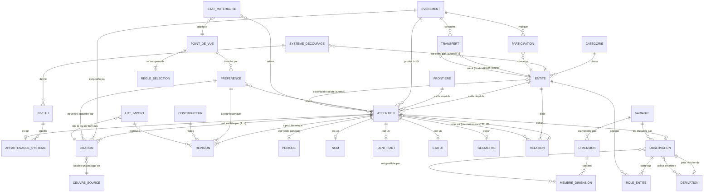
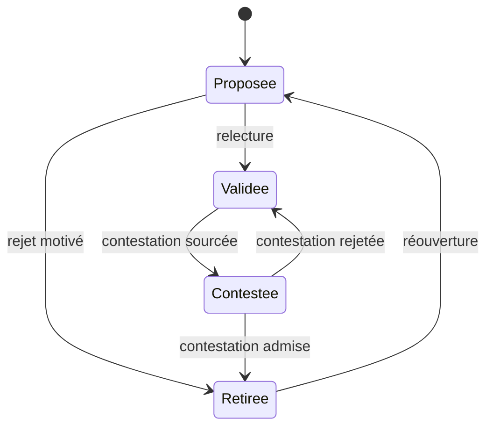
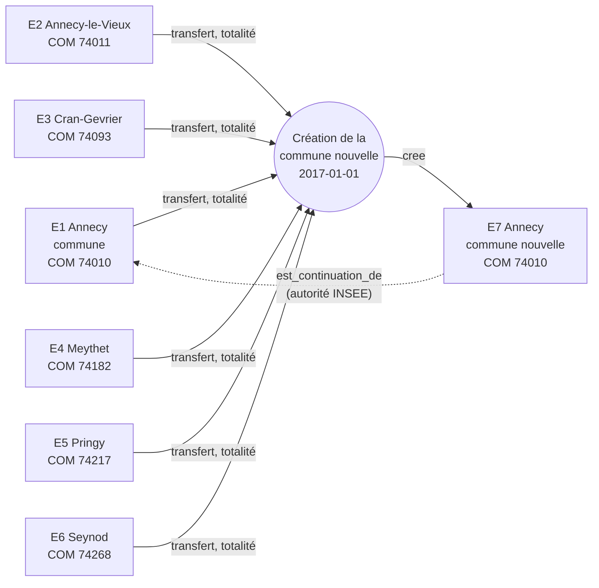
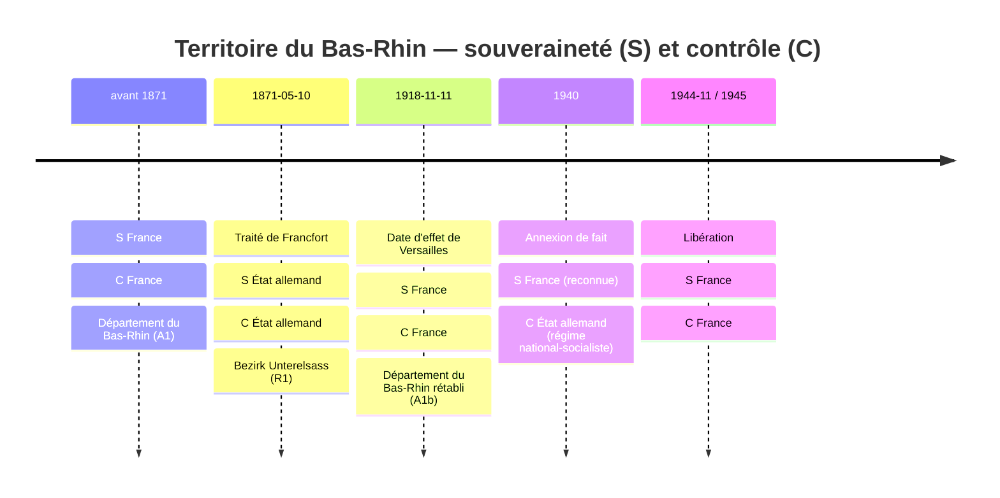
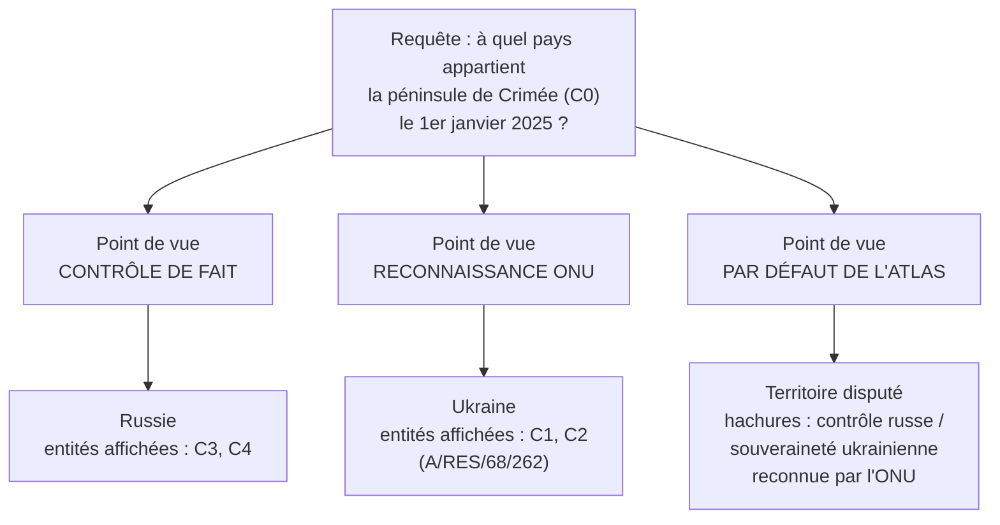

# Modèle de données conceptuel de l'atlas

> **Statut** : version 3 (octobre 2026), figée pour la tranche 1.
> **Portée** : modèle **conceptuel** uniquement. Ce document ne retient aucune technologie de stockage, aucun format d'échange ni aucune bibliothèque. Les termes « entité », « attribut » et « relation » s'entendent au sens conceptuel.

---

## 1. Objet et principes

L'atlas veut rendre lisibles des données du monde entier, de l'échelle mondiale au quartier, de l'Antiquité à aujourd'hui. Chaque donnée doit être **neutre, vérifiable et sourcée** (voir `vision.md`), et la plateforme est enrichie par une communauté.

La difficulté centrale tient à ce que **les territoires changent** : fusions, scissions, cessions, annexions, changements de nom. Toute donnée doit donc être rattachée à une entité **telle qu'elle existait à une date donnée**.

Le modèle repose sur sept principes.

| # | Principe | Conséquence |
|---|----------|-------------|
| P1 | **Tout fait est une assertion.** | Un nom, un code, une géométrie, une appartenance, un statut, une valeur statistique : tout est une affirmation datée, sourcée et qui peut être contredite. Un nouveau type de donnée vient s'ajouter au modèle sans le modifier. |
| P2 | **On sépare l'identité de l'état.** | Une *entité* n'est qu'une identité durable, sans attribut variable. Tout ce qui change dans le temps est porté par des assertions qui ont une période de validité. |
| P3 | **Pas de donnée sans source.** | Chaque assertion a **au moins une citation** précise. Cette contrainte est structurelle : elle ne dépend pas de l'interface. |
| P4 | **Les désaccords sont conservés.** | Des assertions contradictoires coexistent. Pour chaque point de vue, une *préférence* justifiée peut désigner celle qu'on affiche (§10.2). |
| P5 | **La neutralité passe par les points de vue.** | Le modèle n'impose aucune lecture des souverainetés. L'affichage applique un *point de vue* explicite (ONU, contrôle de fait, position d'un État…). |
| P6 | **On garde l'original et on trace le dérivé.** | Une donnée reste rattachée au découpage sur lequel elle a été publiée. Tout recalcul sur un autre découpage est une donnée *dérivée*, dont la méthode et les entrées sont explicites. |
| P7 | **Le modèle est bitemporel et ne perd rien.** | On distingue le temps historique (quand le fait était vrai) du temps d'enregistrement (quand l'atlas l'a affirmé). Rien n'est effacé : une assertion est retirée, jamais supprimée. |

---

## 2. Vue d'ensemble



Lecture rapide :

- **ENTITE** est une identité nue (« Annecy », « Crimée », « Royaume de France »). Tout le reste est assertion.
- **ASSERTION** est le noyau commun. Elle se spécialise en *Nom*, *Identifiant*, *Statut*, *Géométrie*, *Relation*, *Appartenance à un système* et *Observation*. Chacune hérite de la période, de la certitude, des citations, de l'autorité éventuelle et de l'historique de révisions.
- **EVENEMENT** explique les transitions (fusion, cession…). Ses participations disent quelles entités naissent ou disparaissent ; ses **TRANSFERTS** disent quel territoire passe de quelle entité à quelle autre. C'est des transferts qu'on déduit la **filiation** entre entités.
- **OEUVRE_SOURCE / CITATION** : la citation est obligatoire sur toute assertion (cardinalité `1..n`).
- **POINT_DE_VUE** sélectionne, parmi des assertions concurrentes, celles qu'on affiche, par des règles générales puis par des **PREFERENCES** justifiées.
- **ETAT_MATERIALISE** est le résultat calculé d'un point de vue à une date ; **LOT_IMPORT** regroupe les révisions d'un même import.

---

## 3. Le temps

### 3.1 DateHistorique

Une date historique ne se réduit pas à un instant précis. Elle porte :

| Attribut | Rôle | Exemple |
|---|---|---|
| `expression_originale` | La date telle qu'écrite dans la source | « vers 300 av. J.-C. », « 10 mai 1871 », « an XII » |
| `calendrier_origine` | Le calendrier de la source | julien, grégorien, républicain, hégirien… |
| `precision` | La granularité de la date | jour, mois, année, décennie, siècle, millénaire |
| `au_plus_tot` / `au_plus_tard` | Les bornes de l'intervalle d'incertitude, sur une échelle de temps unique et normalisée (proleptique) | « IIe siècle » → [101, 200] |
| `qualificatif` | La nuance de la source | exact, environ, avant, après, présumé |

Règles :
- Toutes les comparaisons se font sur les bornes normalisées. L'expression d'origine n'est jamais perdue.
- Les années avant notre ère se comptent sur une échelle **astronomique** (an 0 = 1 av. J.-C.), pour éviter l'absence d'année zéro. L'affichage reste « av. J.-C. ».
- Une conversion de calendrier est elle-même une opération tracée : on sait qu'une date a été convertie, et selon quelle règle.

### 3.2 Période

Une **période** a un début et une fin, chacun étant une `DateHistorique`. Chaque borne peut être :
- **ouverte** : « jusqu'à aujourd'hui », ou début inconnu ;
- **floue** : les bornes au plus tôt et au plus tard diffèrent.

Une période est **semi-ouverte** : `[début, fin[`. La fusion d'Annecy au 1er janvier 2017 se traduit donc par :
- Annecy-le-Vieux, commune de plein exercice, valide sur `[…, 2017-01-01[` ;
- la commune nouvelle valide sur `[2017-01-01, …[`.

Il n'y a ni jour en double, ni jour manquant.

### 3.3 Bitemporalité

| Axe | Question | Porté par |
|---|---|---|
| **Temps de validité** | Quand le fait était-il vrai dans le monde ? | La `Période` de l'assertion |
| **Temps d'enregistrement** | Depuis quand l'atlas affirme-t-il ce fait, et sous quel statut ? | Les `Révisions` de l'assertion (§10) |

On peut ainsi répondre à : « quelle était la frontière de l'Alsace le 1er juin 1900, **selon l'atlas tel qu'il était le 3 mars 2027** ? » C'est indispensable pour la citabilité de l'atlas lui-même, qui passe par l'état matérialisé (§10.4), et pour l'audit des contributions.

---

## 4. Les entités géographiques

### 4.1 Entité

Une **entité** est une identité durable, **sans attribut variable**. Elle ne porte qu'un identifiant interne permanent et une catégorie. Son nom, sa forme, son rang et ses rattachements sont tous des assertions datées.

Exemples d'entités :
- une commune, un pays, un district allemand ;
- un empire aux limites mouvantes ;
- une région culturelle (le Pays basque) ou naturelle (un bassin versant, une péninsule) ;
- un lieu ponctuel (un champ de bataille) ;
- un carreau statistique, une circonscription électorale.

### 4.2 Catégorie d'entité

Une **taxonomie ouverte**, hiérarchique, que la communauté peut enrichir sans toucher au modèle :

```
politique ─┬─ État souverain
           ├─ entité politique non étatique (peuple, État en exil…)
           └─ empire / confédération
administrative ─ (subdivisions : commune, département, oblast, district…)
statistique / technique ─ (IRIS, carreau, code postal, circonscription…)
culturelle ─ (aire linguistique, région historique…)
naturelle ─ (bassin versant, massif, île, péninsule…)
lieu ─ (site, ville-point, champ de bataille…)
```

La catégorie indique la nature de l'objet. Elle n'impose **pas** de niveau hiérarchique.

### 4.3 Système de découpage et niveaux

La hiérarchie n'est pas universelle. Elle est **propre à chaque système de découpage** :

- un **système de découpage** est un ensemble cohérent de divisions, défini par une **autorité** (§5.6) et valide pendant une période. Exemples : « Divisions administratives de la France » (autorité : la France), « NUTS 2021 » (autorité : l'Union européenne), « Circonscriptions législatives françaises (découpage 2010) », « Divisions administratives de l'Empire allemand », « Diocèses de l'Église catholique » ;
- un **niveau** est un rang à l'intérieur d'un système (commune, canton, département, région ; Gemeinde, Kreis, Bezirk…) ;
- une **appartenance à un système** est une assertion qui place une entité, à un niveau, dans un système, pendant une période, sous une entité parente. Elle hérite de l'autorité du système.

Une même entité peut appartenir **simultanément à plusieurs systèmes**. Annecy est à la fois une commune du système administratif français, une unité LAU du système européen et une partie d'une circonscription législative. Les systèmes ne sont pas tenus de s'emboîter entre eux.

Une entité peut aussi **passer d'un système à un autre** sans changer d'identité : Strasbourg, commune française, devient Gemeinde du Reichsland en 1871, puis redevient commune française (§4.4, §12).

Un système peut lui-même être **contesté**. Pour la Crimée (§13), deux systèmes administratifs concurrents décrivent le même sol.

### 4.4 Règle de rupture d'identité

Quand un territoire change, faut-il **une nouvelle version** de la même entité, ou **une nouvelle entité** ?

**Règle** : une entité garde son identité tant qu'elle n'est ni créée ni supprimée. Il y a **rupture si et seulement si** :
1. l'entité est **créée** : un acte ou un fait fait naître une division, un État, un lieu qui n'existait pas ;
2. l'entité est **supprimée** : elle cesse d'exister, y compris quand elle est **remplacée par une division nouvelle**, c'est-à-dire quand l'acte qui réorganise le territoire institue une autre division au lieu de maintenir l'existante.

Ne sont **jamais** des ruptures, car ce sont des assertions datées sur une entité qui persiste :
- un changement de limites, même important ;
- un changement de nom, de code ou de statut ;
- un changement de régime politique ;
- un changement de niveau (une commune qui devient commune déléguée) ;
- un changement de système d'appartenance (une commune qui passe d'un État à un autre sans être recréée), puisque l'appartenance est elle-même une assertion datée.

**Rétablissement** : une entité rétablie après une suppression est une **nouvelle entité**. Elle est reliée à l'entité supprimée par une relation `est_continuation_de` de sous-type « rétablissement ».

**Qualification sourcée** : dire qu'un acte crée, supprime, remplace ou maintient une entité est une assertion citée (texte de l'acte, table des mouvements du COG…). Quand les sources divergent sur cette qualification, les lectures coexistent comme assertions concurrentes, et une préférence par point de vue tranche (§10.2). Le Haut-Rhin de 1871 en donne un exemple (§12.2).

**Application aux cas du document** :

| Cas | Création ou suppression | Conséquence |
|---|---|---|
| Strasbourg | Commune créée en 1790 avec les municipalités ; jamais supprimée ni remplacée | **Une seule entité S** de 1790 à aujourd'hui. Ses passages entre systèmes français et allemand sont des appartenances datées |
| Commune du canton de Saales (par exemple Saales) | Ni créée ni supprimée en 1871 ni en 1919 | Une seule entité. Appartenances successives : Vosges, puis Kreis Molsheim (Bezirk Unterelsass), puis Bas-Rhin |
| Commune de Moselle cédée en 1871 (par exemple Thionville) | Ni créée ni supprimée | Une seule entité. Noms officiels selon l'autorité : Thionville, Diedenhofen |
| Commune associée, puis rétablie (fusion-association, puis « rétablissement » au sens du COG) | Jamais supprimée : la commune associée persiste | **Une seule entité**. À la fusion-association : statut commune → commune associée, et transfert (X, commune) → (Y, commune). Au retour : statut commune associée → commune, et transfert (Y, commune) → (X, commune). Pas de rupture |
| Commune absorbée par fusion simple, puis rétablie | Supprimée à la fusion, puis rétablie | **Deux entités** : la commune rétablie est nouvelle, reliée à l'ancienne par `est_continuation_de` (rétablissement) |
| Fusion-association transformée en fusion simple | La commune associée est supprimée à la date de la transformation | L'entité s'arrête à cette date. Si la commune est rétablie plus tard, c'est une nouvelle entité |
| Bas-Rhin | Supprimé en 1871 (remplacé par le Bezirk Unterelsass ; qualification *probable*, à vérifier sur l'acte allemand d'organisation), rétabli en 1919 | A1, puis R1, puis **A1b** ; A1b `est_continuation_de` A1 (rétablissement) |
| Haut-Rhin | Non supprimé en 1871 selon la lecture retenue : réduit à la partie restée française | **A2**, une seule entité (§12.2) |
| Moselle | Supprimée en 1871 (sa partie restée française entre dans la Meurthe-et-Moselle ; qualification du Bezirk Lothringen comme division nouvelle *probable*, à vérifier sur l'acte allemand d'organisation), rétablie en 1919 | A3, puis R3, puis **A3b** ; A3b `est_continuation_de` A3 (rétablissement) |
| État allemand | Ni créé ni supprimé entre 1871 et 1945 | **Une seule entité D**. Empire, république et régime national-socialiste sont des statuts successifs |
| Annecy | Commune nouvelle créée en 2017 ; les six communes ne sont pas supprimées | **E7** est une entité nouvelle ; E1 à E6 persistent comme communes déléguées |
| Crimée | C3 et C4 créées par un acte russe en 2014 ; C1 et C2 non supprimées dans le système ukrainien | C3 et C4 sont des entités nouvelles, sans continuation de C1 et C2 |

**Règle d'affichage des séries** : une série temporelle demandée sur une entité suit par défaut les relations `est_continuation_de` de sous-type « rétablissement », vers l'amont comme vers l'aval. La population d'une commune rétablie se prolonge ainsi par celle de la commune supprimée qu'elle rétablit. La rupture est **toujours signalée** à sa date (« entité supprimée le …, rétablie le … »), ainsi que l'écart de limites quand il existe. Chaque valeur reste rattachée à son entité d'origine : la série juxtapose des observations, elle ne les fusionne pas et ne crée aucune donnée dérivée. L'utilisateur peut désactiver ce raccord. Les autres sous-types de `est_continuation_de` ne sont pas suivis par défaut.

---

## 5. Les assertions

### 5.1 Tronc commun

Toute assertion porte :

| Attribut | Description |
|---|---|
| `sujet` | L'entité (ou la frontière, l'événement…) dont on affirme quelque chose |
| `type` | Nom, Identifiant, Statut, Géométrie, Relation, Appartenance, Observation, Transfert (§7.2)… (liste extensible) |
| `contenu` | La valeur affirmée, dont la structure dépend du type |
| `periode_validite` | La `Période` historique (§3.2) |
| `autorite` | L'entité au nom de laquelle le contenu est officiel (§5.6). Obligatoire selon le type |
| `certitude` | Une échelle qualitative : *établi*, *probable*, *possible*, *conjectural* |
| `precision` | Une marge numérique ou spatiale quand elle a un sens (± habitants, ± mètres) |
| `citations` | **1..n** citations (§9). Ce n'est jamais vide. |
| `revisions` | L'historique de contribution (§10) |
| `evenement_origine` / `evenement_fin` | L'événement qui ouvre ou clôt la validité, facultatif |

Deux assertions sont **concurrentes** si elles portent sur le même sujet et le même aspect (par exemple la géométrie d'Annecy), avec des périodes qui se chevauchent et des contenus incompatibles. Le choix entre concurrentes n'est pas un attribut de l'assertion : il relève d'une **préférence** propre à chaque point de vue (§10.2).

### 5.2 Nom

Contenu :
- `texte` ;
- `langue` ;
- `ecriture` (latin, cyrillique, arabe…) ;
- `translitteration` éventuelle ;
- `type_nom` : officiel, endonyme, exonyme, historique, usuel ou abrégé.

Un nom de type *officiel* porte toujours son **autorité** (§5.6).

Une entité peut avoir **plusieurs noms valides au même moment** : plusieurs langues, ou un nom officiel et un nom usuel, ou deux noms officiels selon deux autorités. Exemple : Strasbourg (fr, officiel selon la France), Straßburg (de, officiel selon l'État allemand de 1871 à 1918 ; exonyme sinon), Strossburi (alsacien, endonyme).

### 5.3 Identifiant externe

Contenu :
- `referentiel` (INSEE COG, ISO 3166, NUTS, Wikidata, GeoNames, KOATUU/KATOTTH…) ;
- `type_objet` : le type d'objet que le référentiel distingue, quand il en distingue plusieurs (dans le COG : commune `COM`, commune associée `COMA`, commune déléguée `COMD`, arrondissement municipal `ARM`) ;
- `code`.

Un code n'est **jamais** une clé d'identité. Un même code peut désigner des entités différentes selon l'époque, et une entité peut changer de code. Un même code peut aussi désigner **au même moment** deux entités de types différents : dans le COG, la commune déléguée chef-lieu partage le code de la commune nouvelle (§11.2). Le modèle exige seulement que le triplet (référentiel, type d'objet, code) soit sans ambiguïté **à une date donnée**.

### 5.4 Statut

Contenu : la nature juridique ou politique de l'entité à un moment donné (« commune », « commune nouvelle », « commune déléguée », « Reichsland », « république autonome »…), toujours **selon une autorité** (§5.6). Changer de statut ne fait pas changer d'identité (§4.4).

### 5.5 Relation

Une relation relie un sujet à une **entité cible** et porte un `type_relation` pris dans une liste extensible :

| Type | Sens | Exemple |
|---|---|---|
| `appartient_a` | Inclusion dans un système de découpage (spécialisée en *Appartenance à un système*, §4.3) | Seynod ⊂ Haute-Savoie, de 1860 à 2016 |
| `souverainete_revendiquee_par` | Une entité **revendique** la souveraineté sur le sujet | Crimée ← Ukraine ; Crimée ← Russie |
| `controle_de_fait_par` | Une entité **administre effectivement** le sujet | Crimée ← Russie, depuis 2014 |
| `reconnait` | Une entité (État, organisation) **reconnaît** une autre assertion. La cible est une *assertion*, pas une entité | ONU → reconnaît « Crimée ⊂ Ukraine » |
| `est_continuation_de` | Une continuité affirmée entre deux entités distinctes (§4.4). Sous-types : *rétablissement*, *continuité d'usage*… | Bas-Rhin de 1919 → Bas-Rhin d'avant 1871 (rétablissement) ; commune nouvelle d'Annecy → Annecy (continuité d'usage, autorité INSEE) |
| `voisin_de`, `capitale_de`, … | Relations libres | — |

La relation `reconnait` est **méta** : elle prend une assertion pour objet. C'est ce qui permet de dire « 100 États reconnaissent X, 11 reconnaissent Y » sans qu'aucune lecture ne devienne la vérité du modèle.

### 5.6 Autorité

« Officiel » n'a de sens que rapporté à quelqu'un. L'**autorité** d'une assertion est l'entité (État, collectivité, organisation internationale, institution comme l'INSEE) **au nom de laquelle** le contenu est officiel. Elle se distingue de la source : l'autorité qualifie, la citation documente l'acte par lequel elle l'a fait.

| Type d'assertion | Autorité |
|---|---|
| Nom | Obligatoire si `type_nom` est *officiel* ; sans objet pour un endonyme, un exonyme, un nom usuel ou historique |
| Statut | Obligatoire |
| Appartenance à un système | Celle du système de découpage (§4.3), héritée |
| Identifiant | Le référentiel en tient lieu |
| Relation de continuité | Facultative, quand une institution établit cette continuité (INSEE pour Annecy, §11.2) |
| Autres types | Facultative |

Conséquences :
- plusieurs noms ou statuts officiels peuvent coexister à la même date, selon des autorités différentes (Strasbourg et Straßburg en 1940–1944, §12.2) ;
- une autorité peut ne pas être reconnue : son assertion reste enregistrée et citée, et c'est le point de vue qui décide de l'afficher ;
- un point de vue peut filtrer les assertions par autorité (§10.3).

---

## 6. Versionnement des géométries

### 6.1 La géométrie est une assertion

Une **géométrie** est une assertion comme une autre, qui a un sujet, une période et des citations. Son contenu :

| Attribut | Description |
|---|---|
| `forme` | Polygone ou multi-polygone, point, ligne, ou **zone floue** |
| `zone_floue` | Pour les limites incertaines : un *cœur* (certainement inclus) et une *extension maximale* (peut-être inclus) |
| `precision_spatiale` | L'erreur estimée, en mètres |
| `resolution` | Le niveau de détail adapté (du 1:10 000 au 1:10 000 000) |
| `methode` | Levé officiel, numérisation d'une carte ancienne, reconstitution savante, dérivation d'autres géométries, estimation |
| `geometrie_parente` | Le lien vers la géométrie dont celle-ci est dérivée (simplification, union…) |

### 6.2 Principe de versionnement

- **Une géométrie vaut pour une période.** Quand une limite change, on ne modifie pas la géométrie : on **clôt** sa période et on **ajoute** une nouvelle géométrie.
- Plusieurs géométries peuvent être **valides en même temps** pour une même entité :
  - à des résolutions différentes ;
  - selon des sources concurrentes : deux reconstitutions de la frontière d'un royaume médiéval ;
  - selon des points de vue : la limite revendiquée et la limite contrôlée.
- **L'état d'une entité à une date T** est l'ensemble de ses assertions dont la période contient T. Parmi les concurrentes, le point de vue actif choisit, par ses règles puis par ses préférences (§10.2, §10.3) ; à défaut, les concurrentes sont affichées comme non tranchées.
- Une géométrie dérivée (par exemple la commune nouvelle comme union de six communes) **référence ses géométries d'entrée**. Corriger une entrée signale la dérivée comme « à recalculer ».

### 6.3 Frontières, un objet facultatif

Le modèle de base est fait de **polygones indépendants**. Un contributeur peut ajouter une géométrie sourcée sans toucher aux voisins, et deux tracés contradictoires peuvent coexister. Une topologie partagée imposerait au contraire une seule vérité cohérente, ce qui contredit P4.

Certaines **lignes** ont toutefois un sens propre, historique ou juridique. Elles deviennent alors des objets **Frontière** :
- une ligne fixée par traité (Francfort, 1871) ;
- une ligne de cessez-le-feu ou de démarcation (ligne de contrôle au Cachemire) ;
- une ligne revendiquée ;
- une limite naturelle conventionnelle (talweg d'un fleuve).

Une frontière est un **sujet d'assertions** comme une entité. Elle porte :
- un tracé (une géométrie linéaire datée) ;
- un `type_frontiere` ;
- les entités qu'elle sépare (des relations) ;
- l'événement qui l'a créée (le traité).

Les polygones des entités **ne dérivent pas** des frontières. On peut en revanche vérifier leur concordance.

### 6.4 Cohérence entre voisins : contrôlée, pas imposée

À une date et pour un système de découpage donnés, on attend que les entités d'un même niveau forment une **partition** du territoire parent. Les écarts sont détectés et enregistrés comme **anomalies** :
- **chevauchement** entre deux entités sœurs ;
- **lacune** entre une entité et ses voisines ;
- **débordement** d'une entité fille hors de son parent.

Une anomalie n'est pas forcément une erreur : elle peut traduire un désaccord réel entre sources ou une limite floue. Elle est examinée, puis résolue (correction) ou **expliquée** (désaccord documenté).

---

## 7. Les événements

### 7.1 Événement territorial

Un **événement territorial** explique une transition. Il est daté (une `DateHistorique`, ou une `Période` pour un processus long) et **sourcé** (au moins une citation).

Types, sous forme de liste extensible :
- création, suppression, rétablissement ;
- fusion, absorption, scission ;
- cession, annexion, rétrocession ;
- changement de nom ;
- changement de statut ;
- rectification de limite.

Un événement décrit deux choses distinctes, qu'on ne mélange pas :
- l'**existence** des entités : lesquelles naissent, lesquelles disparaissent, lesquelles persistent en changeant (§4.4). Elle est portée par les **participations** ;
- le **territoire** : quelle portion passe de quelle entité à quelle autre. Il est porté par les **transferts** (§7.2).

Chaque entité impliquée l'est à travers une **participation** dotée d'un rôle :

| Rôle | Sens |
|---|---|
| `cree` | L'entité commence d'exister avec l'événement (création ou rétablissement, §4.4) |
| `supprime` | L'entité cesse d'exister avec l'événement |
| `concerne` | L'entité persiste, et l'événement change l'un de ses attributs : nom, statut, appartenance, limites |
| `acteur` | L'entité qui décide (État signataire, préfecture…) |

Une entité qui persiste et dont seules les limites changent est `concerne` : ce qu'elle perd ou gagne figure dans les transferts. Une cession entre États est un transfert d'un État à l'autre, et non un rôle de participation.

Un événement est relié aux assertions qu'il **ouvre** et à celles qu'il **clôt**.

### 7.2 Transferts de territoire et filiation

Un **transfert** est une assertion dont le sujet est l'événement. Il affirme qu'une portion de territoire, tenue avant l'événement par une entité **source** à un niveau donné, est tenue après par une entité **destination** à un niveau donné.

| Attribut | Description |
|---|---|
| `source` | L'entité qui cède, avec son niveau (commune, département, Bezirk, État…) |
| `destination` | L'entité qui reçoit, avec son niveau |
| `territoire` | Ce qui passe : la totalité de la source, une liste de sous-entités (cantons, communes) ou une géométrie |
| `part` | Facultative : la proportion de la source transmise, en surface ou en population, avec sa propre citation |
| `citations` | 1..n, comme toute assertion |

Le **niveau** compte. En 2017, Annecy-le-Vieux cesse de tenir son territoire **comme commune** au profit de la commune nouvelle, mais continue d'exister comme commune déléguée. Le transfert va donc de (E2, commune) à (E7, commune), sans que E2 soit supprimée. Un transfert peut aussi passer d'un système à un autre : (Bas-Rhin, département) → (Unterelsass, Bezirk) en 1871.

Règles de cohérence, contrôlées comme anomalies (§6.4) :
- une entité `supprime` a transféré la totalité de son territoire, à son niveau, sauf si ce niveau disparaît lui-même du système (le Reichsland en 1918), ou si c'est une subdivision (commune associée, commune déléguée) dont le territoire est déjà tenu, au niveau supérieur, par l'entité dont elle dépend ;
- une entité `cree` reçoit son territoire par des transferts, sauf si elle ne retire de territoire à aucune entité de son niveau : subdivision nouvelle à l'intérieur d'un parent (le Territoire de Belfort en 1871), entité d'un système concurrent (la Crimée russe en 2014), entité statistique ;
- pour une source donnée, la somme des parts transmises dans un même événement ne dépasse pas 1.

**Filiation.** La filiation se **déduit des transferts** : A est parent de B si un transfert va de A à B. Elle ne dépend pas de l'existence : une entité qui persiste peut être parente (le Haut-Rhin cède en 1871 le territoire de l'Oberelsass), et une entité créée peut n'avoir aucun parent (une subdivision nouvelle). On n'en fait pas une relation saisie à part : un seul fait, le transfert, sert de base aux deux lectures, ce qui évite les incohérences.

On en tire un **graphe de filiation** orienté et daté, qu'on peut lire **à un niveau donné** (communal, départemental, étatique). Pour toute entité, on peut remonter ses ancêtres et descendre ses descendants. Les parts des transferts alimentent les tables de passage (§8.4). Une table de passage entre deux dates se calcule en **composant** les transferts successifs le long du graphe.

La filiation ne dit rien de l'identité. La relation `est_continuation_de` (§4.4) est distincte : un rétablissement (A1b → A1) n'est pas un arc de filiation, puisque aucun territoire ne passe directement de A1 à A1b.

### 7.3 Événements et récits généraux

Les batailles, traités, fondations, catastrophes, etc. utilisent **le même cadre** :
- l'événement a un type ;
- il est daté et sourcé ;
- il porte des participations, avec des rôles comme lieu, belligérant ou signataire ;
- il peut avoir une géométrie propre (un point, une zone de combat) ;
- il peut contenir un **récit**, c'est-à-dire un texte rédigé, lui-même rattaché à des citations.

Un événement territorial n'est qu'un événement dont le type a des effets sur les entités.

### 7.4 Correspondance avec les mouvements du COG

Le *Code officiel géographique* de l'INSEE décrit chaque mouvement de commune par un type de modification et par des lignes « avant → après », chacune portant un type de commune (`COM`, `COMA`, `COMD`) et un code. Ses catégories ne coïncident pas avec celles du modèle. En particulier, le « rétablissement » du COG n'est pas toujours un rétablissement au sens du §4.4 : une commune associée qui redevient commune n'a jamais été supprimée.

Principes de lecture :
- une ligne du COG n'est pas une assertion. La traduction lit **l'ensemble des lignes d'un même événement** ;
- le COG ne donne pas d'identifiant d'événement. On regroupe les lignes par date d'effet, type de modification et commune d'arrivée. Ce regroupement est lui-même une interprétation, à vérifier sur les cas de plusieurs mouvements le même jour ;
- le COG ne publie pas la **part** des transferts partiels (création, suppression avec partage, rétablissement). Ces parts restent inconnues tant qu'une autre source ne les donne pas (voir Q13).

Les quatorze types ci-dessous sont tous employés dans la table des événements du COG depuis 1968. X désigne la commune qui change, Y la commune qui l'absorbe ou qui lui cède du territoire.

| Code | Libellé du COG | Traduction dans le modèle | Ambiguïté |
|---|---|---|---|
| 10 | Changement de nom | X `concerne` : nouvelle assertion de nom (autorité : France). Aucun transfert | — |
| 20 | Création | X `cree`. Transferts partiels (commune d'origine, commune) → (X, commune) ; communes d'origine `concerne` (limites) | **Ambigu** quand la ligne n'a pas de commune d'origine (communes de Mayotte au 2011-03-31) : entrée dans le référentiel de communes qui existaient déjà, plutôt qu'une création |
| 21 | Rétablissement | Selon le type de X avant le mouvement : **`COMA` → `COM`** : X `concerne` (statut commune associée → commune), transfert partiel (Y, commune) → (X, commune), pas de rupture ; **`COMD` → `COM`** : même traduction, par analogie, puisque la commune déléguée n'a jamais été supprimée ; **`COM` → `COM`** (ligne partant de Y, code différent) : X `cree`, `est_continuation_de` (rétablissement) vers l'entité supprimée, transfert partiel (Y, commune) → (X, commune), Y `concerne` (limites) | **Ambigu** quand la commune rétablie devient commune associée (lignes `COM` → `COMA` et `COMA` → `COMA` ; trois lignes, en 1983 et 2019) |
| 30 | Suppression | X `supprime`. Transferts (X, commune) → (communes destinataires, commune) ; destinataires `concerne` (limites) | **Ambigu** quand la ligne n'a pas de destinataire (Saint-Barthélemy et Saint-Martin au 2007-02-23) : sortie du référentiel communal par changement de statut, plutôt qu'une suppression |
| 31 | Fusion simple | X `supprime`. Transfert (X, commune) → (Y, commune), totalité ; Y `concerne` (limites) | — |
| 32 | Création de commune nouvelle | La commune nouvelle `cree`. Pour chaque ancienne commune X : transfert (X, commune) → (commune nouvelle, commune), totalité ; puis X `concerne` (statut commune déléguée) si une ligne `COMD` existe pour X à la même date, sinon X `supprime`. Commune associée devenue déléguée (`COMA` → `COMD`) : `concerne` (statut). Commune associée ou déléguée sans ligne `COMD` après le mouvement : `supprime`, sans transfert. La ligne de même code (`COM` X → `COM` X) pour le chef-lieu est aussi celle qui fonde la continuité d'autorité INSEE (§11.2) | **Ambigu** quand une commune nouvelle déjà existante entre dans la nouvelle (lignes `COMD` → `COMD`, `COMD` → `COM`) : suppression de l'ancienne commune nouvelle et création d'une autre, ou extension de la première ? |
| 33 | Fusion association | X `concerne` (statut commune → commune associée). Transfert (X, commune) → (Y, commune), totalité ; Y `concerne` (limites) | — |
| 34 | Transformation de fusion association en fusion simple | X (commune associée) `supprime`, sans transfert : son territoire est déjà tenu par Y au niveau communal ; Y `concerne` | — |
| 35 | Suppression de commune déléguée | X `supprime`, sans transfert : son territoire est déjà tenu par la commune nouvelle | — |
| 41 | Changement de code dû à un changement de département | X `concerne` : nouvel identifiant, nouvelle appartenance. Aucun transfert au niveau communal ; les transferts entre départements relèvent d'événements départementaux | — |
| 50 | Changement de code dû à un transfert de chef-lieu | X `concerne` : nouvel identifiant | **Ambigu** quand la commune a des communes associées : le COG échange aussi leurs codes, et une même ligne relie deux communes associées de noms différents (Tôtes → Saint-Martin-de-Fresnay, 1990). Reste à décider quelles entités persistent, naissent ou disparaissent |
| 70 | Transformation de commune associée en commune déléguée | X `concerne` (statut commune associée → commune déléguée). Aucun transfert | — |
| 71 | Rétablissement de commune déléguée | X `cree`, `est_continuation_de` (rétablissement) vers la commune déléguée supprimée. Transfert partiel (commune déléguée chef-lieu, commune déléguée) → (X, commune déléguée) | — |
| 72 | Création de commune déléguée | X `cree`, subdivision de la commune, sans transfert | **Ambigu** quand la commune déléguée créée porte le nom d'une ancienne commune (Morannes, 2026) : création d'une entité nouvelle, ou rétablissement de l'ancienne commune ? |

Les cas ambigus sont signalés et non tranchés. Aucun ne touche le Bas-Rhin : depuis 1968, les mouvements de ce département relèvent des types 10, 21 (lignes `COM` → `COM` et `COMA` → `COM`), 31, 32, 33, 34, 35 et 71.

---

## 8. Les observations (données)

### 8.1 Variable

Une **variable** décrit *ce qu'on mesure* :
- un libellé et une définition ;
- une unité ;
- une méthode ;
- un type de valeur (quantité, taux, catégorie, texte) ;
- une **règle d'agrégation** (additive comme une population, non additive comme un taux ou un revenu médian) ;
- les **dimensions** qui peuvent la ventiler.

Exemples : « population municipale », « voix obtenues », « taux de chômage au sens du BIT », « migrants (flux annuel) ».

### 8.2 Dimension et membres

Une **dimension** est un axe de ventilation : sexe, tranche d'âge, scrutin, tour, candidat ou liste, nationalité, produit échangé… Ses **membres** sont des valeurs datées et sourcées : le candidat X au scrutin Y.

Les scrutins, les candidats et les partis peuvent eux-mêmes être modélisés comme des entités non géographiques, avec leurs propres assertions. Un parti change de nom, fusionne et se scinde, exactement comme une commune.

### 8.3 Observation

Une **observation** est une assertion dont le contenu est :

| Attribut | Description |
|---|---|
| `variable` | Ce qui est mesuré |
| `entites` | **Une ou plusieurs** entités, chacune avec un rôle : `sujet` (cas général), `origine` / `destination` (flux), `zone_de_reference`… |
| `periode` | La date ou la période de référence de la mesure, à ne pas confondre avec la date de publication |
| `membres` | Un membre par dimension utilisée |
| `valeur` | La valeur, et une marge si elle est connue |
| `nature` | `originale` ou `derivee` ; une dérivée l'est par l'atlas ou par un auteur extérieur (§8.4) |
| `date_geographie` | Pour une observation dérivée : la date du découpage sur lequel la valeur est exprimée (« géographie au 1er janvier 2024 ») |

Cette forme unique couvre :
- les **indicateurs** : population de Seynod en 1990 = (variable *population*, sujet *Seynod*, période *recensement de 1990*) ;
- les **résultats électoraux** : voix de la liste L au 1er tour du scrutin S à Meythet = (variable *voix*, sujet *Meythet*, membres *scrutin S, tour 1, liste L*) ;
- les **flux** : migrants de A vers B en 2010 = (variable *migrants*, origine *A*, destination *B*, période *2010*) ;
- tout **nouveau type** de donnée qui se laisse décrire par une variable, des entités, une période et des dimensions, **sans changer le modèle**.

**Règle de rattachement** : une observation originale désigne l'entité **telle qu'elle existait à la date de référence**. Une observation dérivée désigne l'entité valide à sa `date_geographie` : elle décrit le *territoire* de cette entité, y compris à une date où l'entité n'existait pas encore (§11.4). Sont des **anomalies** : une observation originale dont la période de référence tombe hors de la période de validité de son entité, et une dérivée dont l'entité n'est pas valide à sa date de géographie.

### 8.4 Dérivation : utiliser une donnée sur un autre découpage

Une observation **dérivée** porte une **dérivation**. Toute dérivation a un **auteur** : l'atlas lui-même (dérivation **interne**), ou un producteur extérieur (dérivation **externe**), comme l'INSEE quand il publie des séries de population en géographie courante.

| Attribut | Dérivation interne | Dérivation externe |
|---|---|---|
| `auteur` | L'atlas | Le producteur (une entité) |
| `methode` | Décrite : somme simple, pondération par la surface, pondération par la population, interpolation… | **Citée** : la documentation méthodologique du producteur, résumée si possible |
| `entrees` | Les observations d'entrée, **désignées explicitement** | Facultatives : le producteur ne les publie pas toujours. Une description textuelle suffit (« recensements successifs, chacun dans la géographie de son époque ») |
| `table_de_passage` | Explicite : pour chaque couple (entité d'origine, entité cible), une part et la source de cette part, obtenue en composant les transferts (§7.2) | Facultative : celle du producteur, s'il la publie |
| `avertissement` | Sur la qualité, si besoin (« pondération surfacique, hypothèse d'une densité homogène ») | Idem |

Une dérivée interne cite ses sources **par transitivité** : à travers ses entrées, et à travers la source de sa table de passage. Une dérivée externe cite la publication du producteur, comme le ferait une donnée originale, mais elle reste une **dérivée** : l'atlas ne la présente jamais comme une mesure faite sur le découpage qu'elle décrit. Aucune dérivée n'est confondue avec une donnée originale, et l'interface la signale comme telle, avec son auteur.

**Comparaison des dérivations.** Une dérivée interne et une dérivée externe qui portent sur la même variable, la même entité, la même période et la même date de géographie sont **concurrentes** (§5.1). Leur écart est mesuré :
- quand **tous les transferts composés sont totaux**, la tolérance est **nulle** : tout écart est une anomalie à expliquer (erreur d'une entrée, différence de méthode, erreur de l'une des deux dérivations) ;
- quand la composition comporte des **transferts partiels** dont les parts ne sont pas publiées (§7.4), l'écart est signalé et documenté, sans tolérance fixe.

La valeur affichée par défaut relève d'une préférence (§10.2). Pour les séries de l'INSEE, c'est la valeur de l'INSEE, le recalcul interne restant visible comme contrôle (Q13).

---

## 9. Les sources

### 9.1 Œuvre source

Une **œuvre source** est l'objet bibliographique ou documentaire :

| Attribut | Description |
|---|---|
| `type_source` | **primaire** (texte de loi, recensement, procès-verbal, carte d'époque, traité), **secondaire** (ouvrage d'historien, atlas, article), **dérivée** (jeu de données compilé, base de référence) |
| `titre`, `auteurs`, `editeur` | Description bibliographique |
| `date_publication` | Une `DateHistorique` |
| `version` / `edition` | Indispensable pour les jeux de données révisés (millésime du COG, version NUTS…) |
| `identifiants_persistants` | DOI, ISBN, ARK, cote d'archive, URL pérenne |
| `licence` | Les conditions de réutilisation |
| `langue` | La langue de la source |
| `fiabilite_editoriale` | Une évaluation communautaire, facultative et elle-même sourcée |

Une œuvre peut **contenir** d'autres œuvres : un jeu de données dans une publication, un article dans une revue.

### 9.2 Citation

Une **citation** pointe vers un **endroit précis** d'une œuvre. Elle est **obligatoire** sur chaque assertion :

| Attribut | Description |
|---|---|
| `oeuvre` | L'œuvre citée |
| `localisateur` | Page, article de loi, tableau, ligne et colonne, feuille de carte, horodatage d'archive, identifiant d'enregistrement… |
| `url_consultee` et `copie_archivee` | L'accès en ligne et une copie figée, pour éviter les liens morts |
| `date_consultation` | La date à laquelle on a lu la source en ligne |
| `extrait` | Un court passage cité, facultatif, pour vérifier sans ouvrir la source |
| `role` | Ce que la citation appuie : la valeur, la date, la géométrie, ou une préférence (§10.2) |

### 9.3 Contraintes

1. **Cardinalité** : une assertion qui n'a pas au moins une citation est **refusée**. Elle ne peut pas être enregistrée, même à l'état de proposition.
2. Un **événement** suit la même règle.
3. Une **géométrie** cite sa source cartographique (carte ancienne, levé, texte de délimitation) **et**, le cas échéant, l'œuvre qui l'a numérisée ou reconstituée.
4. Une **préférence** entre assertions concurrentes (§10.2) est justifiée par du texte, et de préférence par une citation : une source secondaire qui tranche le débat.
5. L'**atlas lui-même** n'est jamais une source primaire. Une compilation interne est une dérivation (§8.4) ; un état matérialisé (§10.4) n'est jamais une source.

---

## 10. Contribution, modération et points de vue

### 10.1 Révision

Chaque création ou modification d'une assertion ou d'une préférence ajoute une **révision**. On n'écrase jamais rien.

| Attribut | Description |
|---|---|
| `contributeur` | Qui |
| `horodatage` | Quand (le temps d'enregistrement, §3.3) |
| `operation` | création, correction, changement de statut |
| `statut_apres` | **proposée**, **validée**, **contestée**, **retirée** |
| `motif` | Un commentaire obligatoire sur toute correction ou tout retrait |
| `contenu_precedent` | Ce qui a été remplacé |
| `lot` | Le lot d'import dont la révision fait partie, facultatif (§10.5) |

Cycle de vie :



Une assertion **retirée** reste consultable dans l'historique. Elle ne s'affiche plus par défaut.

### 10.2 Préférence

Quand plusieurs assertions sont concurrentes (§5.1), le choix de celle qu'on affiche est un objet distinct : la **préférence**. Ce n'est pas une assertion : elle n'affirme rien sur le monde, elle consigne un choix éditorial propre à un point de vue.

| Attribut | Description |
|---|---|
| `assertion_retenue` | L'assertion choisie parmi ses concurrentes |
| `point_de_vue` | Le point de vue pour lequel ce choix vaut (§10.3) |
| `justification` | Le texte qui motive le choix, obligatoire |
| `citations` | 0..n citations, recommandées : une source secondaire qui tranche le débat (§9.3) |
| `revisions` | L'historique (§10.1), avec le même cycle de vie que les assertions |

Contraintes :
- pour un même point de vue, deux préférences actives ne peuvent pas désigner des assertions concurrentes dont les périodes se chevauchent ;
- une préférence ne retire rien : les autres assertions restent visibles comme « autres sources ». C'est la transparence voulue par la vision.

**Ordre de résolution** d'un point de vue :
1. ses règles de sélection générales s'appliquent d'abord ;
2. ses préférences tranchent ensuite les cas que les règles ne règlent pas ;
3. sinon, les assertions concurrentes sont affichées comme « non tranché ».

**Préférences du point de vue par défaut de l'atlas.** Elles sont :
- **visibles dans l'interface** : quand l'affichage par défaut retient une assertion parmi des concurrentes, il le signale et donne accès à la justification et aux autres assertions ;
- **encadrées par la politique éditoriale** (`docs/politique-editoriale.md`, à rédiger), qui fixe les critères de choix et la procédure de décision. Une préférence par défaut qui ne s'appuie pas sur cette politique peut être contestée pour ce seul motif.

### 10.3 Point de vue

Un **point de vue** est un ensemble nommé de **règles de sélection** que l'affichage applique aux assertions, complétées par ses **préférences** (§10.2). Exemples :

| Point de vue | Règle principale |
|---|---|
| **Contrôle de fait** | Pour l'appartenance politique, retenir `controle_de_fait_par` |
| **Reconnaissance ONU** | Retenir la souveraineté que reconnaît l'Assemblée générale ou le Conseil de sécurité des Nations unies |
| **Position de l'État X** | Retenir les assertions dont l'autorité est X (§5.6), et la souveraineté que revendique ou reconnaît l'État X |
| **Par défaut de l'atlas** | Appliquer ses préférences, visibles et encadrées par la politique éditoriale. Pour un territoire disputé, afficher la mention « disputé » plutôt que d'imposer une couleur |

Le point de vue est **toujours explicite** dans l'affichage. L'utilisateur sait quelle lecture il regarde, et peut en changer.

### 10.4 État matérialisé

Un **état matérialisé** est le résultat calculé de l'application d'un point de vue aux assertions valides à une date T, selon l'atlas tel qu'il était à une date d'enregistrement R. C'est l'objet que l'on affiche, que l'on exporte et que l'on cite quand on cite l'atlas.

| Attribut | Description |
|---|---|
| `date_validite` | La date historique T (§3.3) |
| `date_enregistrement` | La date R : l'état de l'atlas pris en compte |
| `point_de_vue` | Le point de vue appliqué, avec sa version |
| `perimetre` | Ce qui est calculé : système de découpage, niveaux, emprise, variables |
| `assertions_retenues` | Les assertions sélectionnées |
| `preferences_appliquees` | Les préférences qui ont tranché |
| `anomalies` | Les anomalies rencontrées (§6.4, §8.3) |
| `date_calcul` | Quand le calcul a été fait |
| `etat` | *à jour*, ou *obsolète* si une entrée a changé depuis R |

Règles :
- il est **tracé comme une dérivation** : ses entrées et sa méthode sont explicites, et le même triplet (T, point de vue, R) donne toujours le même résultat ;
- il **ne crée aucune assertion**. Il se distingue en cela de la dérivation du §8.4, qui produit des observations ;
- il n'est **jamais une source** (§9.3) ;
- il est le **support de citation** de l'atlas : citer l'atlas, c'est citer un triplet (T, point de vue, R).

### 10.5 Lot d'import

Un **lot d'import** regroupe les révisions issues d'un même import de données, par exemple un millésime du recensement pour toutes les communes d'un département.

| Attribut | Description |
|---|---|
| `citation_jeu_de_donnees` | La citation de l'œuvre importée, avec sa version ou son millésime (§9.1) |
| `responsable` | Le contributeur qui porte le lot |
| `horodatage` | Le temps d'enregistrement du lot |
| `procedure` | La description de la correspondance entre le jeu source et le modèle : variables, entités, dimensions |
| `perimetre` | Ce que le lot couvre : territoire, période, variables |
| `rapport_de_validation` | Le nombre d'assertions créées, modifiées et rejetées ; les anomalies détectées (§6.4, §8.3) ; les contrôles effectués ; l'échantillon relu par un humain |
| `statut` | proposé, validé, partiellement validé, rejeté |

Règles :
- chaque assertion du lot garde **sa propre** citation, dont le localisateur désigne la ligne ou l'enregistrement dans le jeu de données. Le lot ne remplace pas la citation : P3 n'est pas affaibli ;
- valider le lot valide les révisions du lot encore au statut « proposée » ;
- une contestation ultérieure vise une assertion, pas le lot.

**Règle d'acceptation d'un lot** :
1. **Contrôles automatiques obligatoires.** Un lot qui échoue à l'un d'eux est refusé sans relecture.
2. **Échantillon stratifié vérifié par un autre acteur.** Le vérificateur est un acteur différent de celui qui a réalisé l'import : en pratique, un agent importe et un humain vérifie. Pour chaque élément de l'échantillon, il compare à la source la valeur, l'entité, l'identifiant et le localisateur de la citation. La liste tirée est consignée dans le rapport de validation.
3. **Rejet au moindre écart** imputable à l'import dans l'échantillon.
4. **Erratum de la source.** Un écart dû à la source elle-même (erratum, rectificatif publié) n'est pas un motif de rejet. Il est enregistré comme une assertion concurrente, citée sur le rectificatif.
5. **Lot corrigé.** Un lot corrigé est soumis comme un **nouveau lot**. Le lot rejeté reste consultable (P7).

**Paramètres pour la tranche 1** (population communale du Bas-Rhin) :

| Contrôle | Paramètre |
|---|---|
| Codes | Chaque triplet (INSEE COG, type d'objet, code) existe dans le COG à la **date de géographie de la publication** : géographie de l'époque pour une publication d'époque, géographie courante pour une série de l'INSEE |
| Complétude | Aucune commune du Bas-Rhin présente dans le COG à cette même date, pour les types d'objets que couvre la publication, ne manque ni n'est en double |
| Total | La somme des communes est égale au total départemental publié, sans écart |
| Variation | Les communes dont la variation par rapport au recensement précédent dépasse un seuil sont signalées dans le rapport et examinées par le vérificateur. Une variation qu'aucun mouvement du COG ni la source n'explique est traitée comme un écart de l'échantillon. Seuil : une commune est signalée si sa variation dépasse **à la fois 30 % et 50 habitants**. Ces valeurs seront réévaluées après le premier import |
| Recalcul | Pour un lot de séries de l'INSEE en géographie courante : comparaison avec le recalcul par le graphe de filiation, selon les tolérances du §8.4 |
| Échantillon | 15 communes : les 5 plus peuplées ; 5 communes touchées par un mouvement du COG sur la période couverte ; 5 tirées au hasard |

---

## 11. Cas 1 : la commune nouvelle d'Annecy (1er janvier 2017)

### 11.1 Les faits

Au **1er janvier 2017**, les communes d'**Annecy**, **Annecy-le-Vieux**, **Cran-Gevrier**, **Meythet**, **Pringy** et **Seynod** (Haute-Savoie) se regroupent en une **commune nouvelle** nommée **Annecy**. Elle a été créée par arrêté préfectoral de 2016 et reprend le code INSEE **74010** de l'ancienne Annecy. Les six anciennes communes deviennent des **communes déléguées**. Chacune garde son code dans le COG, avec le type `COMD`. L'ancienne Annecy, commune déléguée chef-lieu, garde donc elle aussi le code 74010.

Le cas est délicat. En droit, la commune nouvelle est une **nouvelle collectivité**. Dans l'usage et dans le référentiel des codes, c'est « Annecy » qui continue, avec un territoire plus grand.

### 11.2 Modélisation

**Entités** (identités) :

| Id. | Catégorie | Commentaire |
|---|---|---|
| E1 | administrative | Annecy (la commune historique, puis la commune déléguée chef-lieu) |
| E2 | administrative | Annecy-le-Vieux |
| E3 | administrative | Cran-Gevrier |
| E4 | administrative | Meythet |
| E5 | administrative | Pringy |
| E6 | administrative | Seynod |
| E7 | administrative | Annecy, commune nouvelle |

> **Application de la règle** (§4.4) : la commune nouvelle est **créée** par l'arrêté. E7 est donc une entité distincte de E1. Les six anciennes communes ne sont pas supprimées : elles changent de statut et d'appartenance. Une relation `est_continuation_de` (E7 → E1), de sous-type *continuité d'usage* et d'autorité **INSEE**, traduit la continuité que retient le référentiel. Elle est citée sur la table des mouvements du COG, qui enregistre au 2017-01-01 un passage de la commune 74010 à la commune 74010.

**Événement** :

| Attribut | Valeur |
|---|---|
| Type | création de commune nouvelle (fusion) |
| Date | 2017-01-01, précision jour |
| Participations | E7 : `cree` ; E1 à E6 : `concerne` (statut et appartenance : ils deviennent communes déléguées) ; préfecture de la Haute-Savoie : `acteur` |
| Transferts | (E1, commune) → (E7, commune), totalité ; de même pour E2, E3, E4, E5 et E6. Aucune des six n'est supprimée : elles cessent seulement de tenir leur territoire au niveau communal |
| Citation | Arrêté préfectoral portant création de la commune nouvelle d'Annecy (2016), *Recueil des actes administratifs de la préfecture de la Haute-Savoie* ; INSEE, *Code officiel géographique*, millésime 2017, table des mouvements de communes (type de modification 32, « création de commune nouvelle ») |

**Assertions principales** :

| Sujet | Type | Contenu | Autorité | Période | Citation |
|---|---|---|---|---|---|
| E2 | Statut | commune | France | […, 2017-01-01[ | COG INSEE, historique des communes |
| E2 | Statut | commune déléguée | France | [2017-01-01, …[ | Arrêté de création |
| E2 | Appartenance | commune de la Haute-Savoie | France (système) | […, 2017-01-01[ | COG INSEE |
| E2 | Appartenance | commune déléguée de E7 | France (système) | [2017-01-01, …[ | Arrêté de création |
| E2 | Identifiant | INSEE COG, `COM`, 74011 | (référentiel) | […, 2017-01-01[ | COG INSEE |
| E2 | Identifiant | INSEE COG, `COMD`, 74011 | (référentiel) | [2017-01-01, …[ | COG INSEE 2017, table des mouvements |
| E1 | Identifiant | INSEE COG, `COM`, 74010 | (référentiel) | […, 2017-01-01[ | COG INSEE |
| E1 | Identifiant | INSEE COG, `COMD`, 74010 | (référentiel) | [2017-01-01, …[ | COG INSEE 2017, table des mouvements |
| E1 | Statut | commune déléguée (chef-lieu) | France | [2017-01-01, …[ | Arrêté de création |
| E7 | Nom | « Annecy » (fr, officiel) | France | [2017-01-01, …[ | Arrêté de création |
| E7 | Identifiant | INSEE COG, `COM`, 74010 | (référentiel) | [2017-01-01, …[ | COG INSEE 2017 |
| E7 | Géométrie | union des géométries E1 à E6 (méthode : dérivation) | — | [2017-01-01, …[ | IGN, référentiel administratif, millésime 2017 |
| E7 | Relation | `est_continuation_de` E1 (continuité d'usage) | INSEE | [2017-01-01, …[ | COG INSEE 2017, table des mouvements (ligne 74010 → 74010) |

E3 à E6 suivent le même schéma que E2.

> Depuis 2017, le code **74010** est porté **en même temps** par deux entités : E7 comme commune (`COM`) et E1 comme commune déléguée (`COMD`). Le triplet (référentiel, type d'objet, code) reste sans ambiguïté à toute date (§5.3). Une recherche sur le seul code renverrait deux entités emboîtées.

### 11.3 Filiation



Les flèches pleines sont des **transferts au niveau communal** : ce sont elles qui fondent la filiation E1…E6 → E7 (§7.2). Après l'événement, E1 à E6 **continuent d'exister** comme entités, avec un nouveau statut (commune déléguée), une nouvelle appartenance (à E7) et un identifiant de type `COMD`. La relation en pointillé relève de l'identité, pas de la filiation.

### 11.4 Donnée dérivée : la population de 1990 sur le territoire de 2017

1. Les **observations originales** sont la population municipale au recensement de 1990 de **E1 à E6**, chacune rattachée à la commune telle qu'elle existait en 1990, et citée sur la publication INSEE du recensement de 1990 (tableau par commune).
2. L'**observation dérivée** est la population « 1990 » du territoire E7 :
   - méthode : **somme simple**. La variable est additive et le territoire de E7 est exactement l'union de E1 à E6, sans partage partiel ;
   - entrées : les six observations originales ;
   - table de passage : six parts de 1,0, données par les six transferts de l'événement de 2017. Si aucun autre transfert ne touche E1 à E6 entre 1990 et 2017, la composition se réduit à ce seul événement ; sinon, les transferts intermédiaires (rectifications de limites) s'y composent ;
   - auteur : l'atlas (dérivation interne) ;
   - date de géographie : 2017-01-01, date à laquelle E7 est valide ;
   - nature : `derivee`.

   L'INSEE publie de son côté des séries en géographie courante. Sa valeur pour le territoire de E7 en 1990 est une **dérivation externe** (§8.4), concurrente de la précédente et comparée avec elle. Les six transferts étant totaux, la tolérance d'écart est nulle. La valeur de l'INSEE est affichée par défaut, et le recalcul interne reste visible comme contrôle (Q13).
3. **Requête** « population d'Annecy en 1990 ». Le système doit lever l'ambiguïté :
   - **Annecy de 1990 (E1)** : une observation originale ;
   - **territoire de l'Annecy actuelle (E7)** : une observation dérivée, explicitement signalée. E7 n'existait pas en 1990 : la donnée décrit son *territoire*, pas l'entité.

La relation E7 → E1 n'est pas un rétablissement : la règle d'affichage des séries (§4.4) ne la suit pas par défaut.

---

## 12. Cas 2 : l'Alsace-Moselle (1871–1945)

### 12.1 Les faits

| Date | Événement |
|---|---|
| **10 mai 1871** | **Traité de Francfort** : la France cède à l'Empire allemand l'essentiel de l'Alsace (Bas-Rhin, Haut-Rhin moins l'arrondissement de Belfort, cantons vosgiens de Schirmeck et de Saales) et une partie de la Lorraine (la majeure partie de la Moselle, une partie de la Meurthe). |
| 1871 | Création du **Reichsland Elsaß-Lothringen** (loi d'Empire du 9 juin 1871), divisé en trois districts (*Bezirke*) : **Unterelsass**, **Oberelsass**, **Lothringen**. Les cantons de Schirmeck et de Saales sont rattachés à l'Unterelsass. Côté français, les parties restantes de la Meurthe et de la Moselle forment le département de **Meurthe-et-Moselle**. La partie du Haut-Rhin restée française forme le **Territoire de Belfort**, qui demeure en droit la partie conservée du département du Haut-Rhin, dont le chef-lieu reste théoriquement Colmar. |
| **11 novembre 1918** | Armistice. Le traité de Versailles fera remonter le retour à la France à cette date. |
| **28 juin 1919** (entrée en vigueur le 10 janvier 1920) | **Traité de Versailles**, article 51 : les territoires cédés en 1871 reviennent à la France **avec effet au 11 novembre 1918**. Les districts deviennent les départements du **Bas-Rhin**, du **Haut-Rhin** et de la **Moselle**, dans les limites des districts. Les cantons de Schirmeck et de Saales restent dans le Bas-Rhin. |
| **1922** | Le Territoire de Belfort reçoit le statut de département. |
| **1940** | Après l'armistice du 22 juin 1940, **annexion de fait** par le Reich : l'Alsace est rattachée à l'administration civile du *Gau* de Bade, la Moselle à celle du *Gau* Westmark. Cette annexion n'est **jamais reconnue en droit international** : la France reste souveraine *de jure*. |
| **Novembre 1944 – mars 1945** | Libération progressive : Metz et Strasbourg en novembre 1944, la poche de Colmar en février 1945, les dernières communes de Moselle en mars 1945. Le contrôle de fait redevient français, **commune par commune**. |

### 12.2 Modélisation

**Entités** (extrait) :

| Id. | Entité | Catégorie |
|---|---|---|
| A1 | Bas-Rhin (département, jusqu'en 1871) | administrative |
| A1b | Bas-Rhin (département rétabli en 1919) | administrative |
| A2 | Haut-Rhin (département) | administrative |
| A3 | Moselle (département, jusqu'en 1871) | administrative |
| A3b | Moselle (département rétabli en 1919) | administrative |
| A4 | Meurthe (département) | administrative |
| A5 | Meurthe-et-Moselle (département) | administrative |
| A6 | Territoire de Belfort | administrative |
| V | Vosges (département) | administrative |
| R0 | Reichsland Elsaß-Lothringen | administrative |
| R1 | Bezirk Unterelsass | administrative |
| R2 | Bezirk Oberelsass | administrative |
| R3 | Bezirk Lothringen | administrative |
| F | France | politique (État souverain) |
| D | État allemand (*Deutsches Reich*, 1871–1945) | politique (État souverain) |
| S | Strasbourg (commune / Gemeinde) | administrative |
| SA | Saales (commune / Gemeinde) | administrative |
| T | Thionville (commune / Gemeinde) | administrative |

> **Application de la règle** (§4.4) :
> - **Bas-Rhin** : la réorganisation allemande de 1871 remplace le département par une division nouvelle, le Bezirk Unterelsass. A1 est donc supprimé, et R1 créé. Certitude de cette qualification : *probable*. **À vérifier sur l'acte allemand d'organisation.** En 1919, R1 est supprimé et le Bas-Rhin rétabli : c'est une nouvelle entité **A1b**, reliée à A1 par `est_continuation_de` (rétablissement) et descendante de R1 par le transfert de la rétrocession. Le gain des cantons de Schirmeck et de Saales est un changement de limites de A1b par rapport à A1, sans effet sur l'identité.
> - **Moselle** : même schéma (A3, R3, A3b), avec la même certitude *probable* sur la qualification du Bezirk Lothringen comme division nouvelle. **À vérifier sur l'acte allemand d'organisation.** La partie de A3 restée française entre en 1871 dans la Meurthe-et-Moselle, créée à partir des restes de A3 et de A4, qui sont tous deux supprimés.
> - **Haut-Rhin** : en droit français, le département n'est pas supprimé en 1871. Il est réduit à la partie restée française, sous le nom d'usage de Territoire de Belfort. **A2 est donc une seule entité**. Il récupère le territoire de R2 en 1919, et perd celui de A6 quand le Territoire de Belfort devient un département en 1922. A6 est créé en 1871 comme circonscription à l'intérieur de A2, puis change de statut et d'appartenance en 1922. Une lecture concurrente tient le Haut-Rhin pour supprimé en fait en 1871, la partie restée française étant administrée à part. Elle est enregistrée comme une assertion concurrente sur la qualification de l'événement, et la préférence du point de vue par défaut retient la lecture juridique, citée sur la préfecture du Territoire de Belfort.
> - **Communes** (S, SA, T) : aucune n'est créée ni supprimée. Leurs passages du système français au système allemand et retour sont des appartenances datées.
> - **État allemand** : D n'est ni créé ni supprimé entre 1871 et 1945. L'Empire, la république de Weimar et le régime national-socialiste sont des **statuts** successifs de D, et non des entités distinctes.

**Statuts de l'État allemand (D)** :

| Statut | Autorité | Période | Citation |
|---|---|---|---|
| empire | D | [1871-01-18, 1918-11[ | Constitution de l'Empire allemand (1871) |
| république | D | [1918-11, 1933[ | Constitution de Weimar (1919) |
| régime national-socialiste | D | [1933, 1945[ | Sources secondaires d'histoire constitutionnelle |

Le nom officiel *Deutsches Reich* (de, autorité D) reste le même sur toute la période. « Empire allemand » et « Reich allemand » sont des exonymes français datés.

**Événements** :

| Événement | Date | Participations (existence) | Transferts (territoire) | Citation |
|---|---|---|---|---|
| Cession de Francfort | 1871-05-10 (signature) | F, D `acteur` | (F, État) → (D, État) : les territoires énumérés à l'article 1 | *Traité de paix entre la France et l'Allemagne*, Francfort, 10 mai 1871, art. 1 ; *Journal officiel de la République française* |
| Création du Reichsland et des Bezirke | 1871 | D `acteur` ; A1 `supprime` ; R0, R1, R2, R3 `cree` ; A2, A3, A4, V `concerne` (limites) ; S, SA, T `concerne` (appartenance) | (A1, département) → (R1, Bezirk) : totalité ; (V, département) → (R1, Bezirk) : cantons de Schirmeck et de Saales ; (A2, département) → (R2, Bezirk) : le Haut-Rhin moins l'arrondissement de Belfort ; (A3, département) → (R3, Bezirk) : la partie annexée ; (A4, département) → (R3, Bezirk) : la partie annexée. R0 est créé sans transfert : il regroupe les trois Bezirke à un niveau supérieur | Loi d'Empire du 9 juin 1871 ; actes allemands d'organisation administrative de 1871 |
| Création du Territoire de Belfort | 1871 | A6 `cree` (subdivision au sein de A2) | Aucun : A2 garde son territoire, A6 s'y inscrit | Texte de délimitation ; ouvrage d'histoire administrative (source secondaire) |
| Création de Meurthe-et-Moselle | 1871 | A3, A4 `supprime` ; A5 `cree` | (A3, département) → (A5, département) : la partie restée française ; (A4, département) → (A5, département) : la partie restée française | Loi française de 1871 (délimitation) |
| Rétrocession | **1918-11-11** pour l'effet ; 1919-06-28 pour la signature ; 1920-01-10 pour l'entrée en vigueur | D, F `acteur` ; R0, R1, R2, R3 `supprime` ; A1b, A3b `cree` ; A2 `concerne` (limites) ; S, SA, T `concerne` (appartenance) | (D, État) → (F, État) ; (R1, Bezirk) → (A1b, département) : totalité ; (R2, Bezirk) → (A2, département) : totalité ; (R3, Bezirk) → (A3b, département) : totalité. R0 disparaît avec son niveau | *Traité de Versailles*, 28 juin 1919, partie III, section V, art. 51 ; actes français de réorganisation départementale |
| Érection du Territoire de Belfort en département | 1922 | A6 `concerne` (statut, appartenance) ; A2 `concerne` (limites) | (A2, département) → (A6, département) : le territoire de A6 | Texte de 1922 portant le statut de département ; préfecture du Territoire de Belfort (source secondaire) |
| Annexion de fait | 1940 (période floue : été et automne 1940) | D `acteur` ; A1b, A2, A3b `concerne` (contrôle) | Aucun : l'annexion n'est pas reconnue, et le contrôle de fait est une relation (voir ci-dessous) | Ouvrages d'histoire de l'annexion (sources secondaires) ; actes de l'administration civile allemande (primaires) |
| Libération | période [1944-11, 1945-03] | F `acteur` ; A1b, A2, A3b `concerne` (contrôle) | Aucun | Sources secondaires d'histoire militaire |

> **Filiation qui en résulte** (§7.2), au niveau départemental : A1 → R1 → A1b ; A2 → R2 → A2 ; A3 → R3 → A3b ; A4 → R3 ; V → R1 ; A3 → A5 ; A4 → A5 ; A2 → A6. Le Haut-Rhin, qui n'est jamais supprimé, est à la fois parent et descendant de R2. Les relations de rétablissement A1b → A1 et A3b → A3 n'en font pas partie.

> La rétrocession montre qu'**un même événement peut porter plusieurs dates** (signature, entrée en vigueur, date d'effet). Le modèle les distingue comme trois assertions datées de l'événement, chacune citée. La période de validité des assertions territoriales s'appuie sur la **date d'effet**.
>
> Les relations `est_continuation_de` A1b → A1 et A3b → A3 (rétablissement) sont des assertions distinctes, citées sur les actes français de 1919. Elles permettent la règle d'affichage des séries (§4.4) : une série sur le Bas-Rhin actuel se prolonge avant 1871, avec la rupture signalée.

**Assertions sur la souveraineté et le contrôle** (territoire du Bas-Rhin, porté successivement par A1, R1 et A1b) :

| Sujet | Relation | Cible | Période | Citation |
|---|---|---|---|---|
| A1 | `souverainete_revendiquee_par` | F | […, 1871-05-10[ | Traité de Francfort |
| R1 | `souverainete_revendiquee_par` | D | [1871-05-10, 1918-11-11[ | Traité de Francfort |
| A1b | `souverainete_revendiquee_par` | F | [1918-11-11, …[ | Traité de Versailles, art. 51 |
| A1b | `controle_de_fait_par` | F | [1918-11, 1940-06/07[ | Sources historiques |
| A1b | `controle_de_fait_par` | D | [1940 (été), 1944-11 / 1945-02[ | Sources historiques. Fin **floue** et **différente selon les communes** |
| A1b | `souverainete_revendiquee_par` | D | [1940, 1945[ | Actes allemands. Annexion **non reconnue** |
| — | `reconnait` (sujet : la France libre, puis les Alliés) | l'assertion « souveraineté F » sur A1b | [1940, 1945[ | Déclarations alliées (source secondaire de synthèse) |

> **1940–1945** est l'exemple type d'une **divergence entre contrôle et souveraineté**. Les deux lectures coexistent :
> - en **point de vue « contrôle de fait »**, l'Alsace apparaît allemande en 1942 ;
> - en **point de vue « droit international / souveraineté reconnue »**, elle reste française.

**Noms de Strasbourg (S)** :

| Nom | Langue | Type | Autorité | Période | Citation |
|---|---|---|---|---|---|
| Strasbourg | fr | officiel | F | [1790, 1871-05-10[ ∪ [1918-11-11, …[ | Textes administratifs français |
| Straßburg | de | officiel | D | [1871-05-10, 1918-11-11[ | Textes administratifs allemands |
| Straßburg | de | officiel | D (annexion non reconnue) | [1940 (été), 1944-11-23[ | Actes de l'administration civile allemande |
| Straßburg | de | exonyme | — | sans borne | Usage germanophone (ouvrage de référence) |
| Strossburi | gsw (alsacien) | endonyme | — | sans borne | Ouvrage de dialectologie |

> Le nom officiel français est **continu depuis 1918**, sans interruption en 1940 : la France reste souveraine *de jure* et ne renomme pas la commune. De 1940 à 1944, deux noms officiels coexistent selon deux autorités, et le point de vue choisit celui qu'on affiche.
>
> *Argentoratum* ne figure pas ici : la commune S est créée en 1790, et le nom antique désigne une entité distincte, l'établissement romain (catégorie *lieu*), reliée à S par une relation sourcée si besoin.

### 12.3 Chronologie



### 12.4 Une observation sur un découpage disparu

Le **recensement allemand du 1er décembre 1900** donne la population par *Gemeinde* et par *Kreis* du Reichsland :
- les observations sont rattachées aux entités **valides en 1900** : la commune S (nommée Straßburg selon l'autorité allemande) et le Bezirk Unterelsass (R1), avec une citation de la publication statistique impériale (volume, tableau, ligne) ;
- la variable reste celle de la source : « ortsanwesende Bevölkerung », la population présente. Elle **n'est pas fusionnée** avec la population municipale française. Une **correspondance entre variables** peut être déclarée, avec sa réserve méthodologique ;
- la population de 1900 **du département du Bas-Rhin actuel (A1b)** est une observation **dérivée** (dérivation interne, date de géographie actuelle). Elle se calcule de deux façons, qui se contrôlent l'une l'autre :
  - **au niveau communal** : les Gemeinden de 1900 transmettent leur territoire aux communes actuelles par les transferts des fusions, rétablissements et rectifications de limites ultérieurs. On compose ces transferts (§7.2), puis on somme sur les communes qui appartiennent aujourd'hui à A1b ;
  - **au niveau départemental**, si le total du Bezirk est publié : le seul transfert (R1 → A1b, totalité), composé avec les éventuels transferts ultérieurs touchant A1b, donne la même valeur à partir de l'observation de R1.

  La variable reste « ortsanwesende Bevölkerung » : la dérivation change le découpage, pas la définition de la mesure.

### 12.5 Requête type

> « À quel pays appartenait Strasbourg le 15 juin 1942 ? »
> - **Point de vue contrôle de fait** → État allemand, sous régime national-socialiste (certitude : établi). Nom affiché : *Straßburg*, officiel selon l'autorité allemande.
> - **Point de vue souveraineté reconnue** → France. Annexion non reconnue, citée. Nom affiché : *Strasbourg*.
> - **Par défaut de l'atlas** → les deux sont affichés, avec la mention « annexion de fait, non reconnue en droit international ».

---

## 13. Cas 3 : la Crimée (depuis 2014)

### 13.1 Les faits

| Date | Événement |
|---|---|
| Avant 2014 | La péninsule relève de l'Ukraine : **République autonome de Crimée** et **ville à statut spécial de Sébastopol**. |
| **16 mars 2014** | Référendum organisé par les autorités locales, jugé illégal par l'Ukraine. |
| **18 mars 2014** | Traité d'intégration signé à Moscou. La Russie crée la « **République de Crimée** » et la « **ville fédérale de Sébastopol** », ratifiées par la loi russe du 21 mars 2014. |
| **27 mars 2014** | **Résolution A/RES/68/262** de l'Assemblée générale des Nations unies, « Intégrité territoriale de l'Ukraine » : elle affirme l'intégrité territoriale de l'Ukraine et déclare le référendum sans validité. |
| 2014–2016 | Côté russe, un district fédéral de Crimée est créé, puis rattaché au district fédéral du Sud en juillet 2016. |
| Depuis 2014 | Contrôle de fait russe. L'Ukraine considère le territoire comme temporairement occupé (loi ukrainienne du 15 avril 2014). |

### 13.2 Modélisation

**La péninsule** est une entité à part entière : **C0, péninsule de Crimée**, de catégorie *naturelle*, hors de tout système de découpage. Elle porte les noms géographiques, sans autorité.

**Deux systèmes de découpage concurrents** décrivent **le même sol** :

| Système (autorité) | Entités sur la péninsule |
|---|---|
| Divisions administratives de l'Ukraine (Ukraine) | C1 République autonome de Crimée ; C2 ville de Sébastopol (statut spécial) |
| Divisions administratives de la Fédération de Russie (Russie) | C3 République de Crimée (sujet fédéral) ; C4 ville fédérale de Sébastopol |

> **Application de la règle** (§4.4) : C3 et C4 sont **créées** par un acte russe. Ce sont des **entités nouvelles**, et non des continuations de C1 et C2 : aucune source ne pose cette continuité d'un point de vue neutre, et l'Ukraine conteste leur existence même. C1 et C2 ne sont pas supprimées dans le système ukrainien. La géométrie de C3 et C4 **recouvre** celle de C1 et C2. Ce recouvrement est une **anomalie expliquée** (§6.4) : il ne s'agit pas d'une erreur, mais de deux systèmes concurrents.

**Événements** :

| Événement | Date | Participations (existence) | Transferts (territoire) | Citation |
|---|---|---|---|---|
| Annexion (selon la lecture russe : « intégration ») | 2014-03-18 (traité) ; 2014-03-21 (ratification) | Russie `acteur` ; C3, C4 `cree` dans le système russe, sans transfert : C1 et C2 ne perdent rien dans le système ukrainien | (Ukraine, État) → (Russie, État) : la péninsule. Transfert affirmé par les actes russes et **contesté** : assertion concurrente de la qualification de l'A/RES/68/262 | Traité du 18 mars 2014 et loi constitutionnelle fédérale du 21 mars 2014 (primaires) ; A/RES/68/262 (qualification contraire) |

Le *type* même de l'événement est disputé. « Annexion » et « réunification » sont deux **assertions concurrentes sur le type** de l'événement, citées chacune. Le point de vue choisit le libellé, et le libellé par défaut de l'atlas est fixé par une préférence justifiée sur une source de référence (§10.2).

**Assertions** (sujet : C1, République autonome de Crimée) :

| Type | Contenu ou cible | Autorité | Période | Citation |
|---|---|---|---|---|
| Statut | république autonome | Ukraine | [1991/1992, …[ | Constitution de l'Ukraine |
| Statut | territoire temporairement occupé | Ukraine | [2014, …[ (date de début fixée par la loi ukrainienne) | Loi ukrainienne du 15 avril 2014 et ses modifications |
| `appartient_a` (système ukrainien) | Ukraine | Ukraine (système) | [1991/1992, …[ | Constitution de l'Ukraine |
| `souverainete_revendiquee_par` | Ukraine | Ukraine | [1991, …[ | Constitution de l'Ukraine ; loi du 15 avril 2014 |
| `controle_de_fait_par` | Ukraine | — | [1991, 2014-02/03[ | Sources secondaires. Fin **floue** (fin février à mars 2014) |
| `controle_de_fait_par` | Russie | — | [2014-03, …[ | Sources secondaires |
| `reconnait` (sujet : ONU, Assemblée générale) | l'assertion « C1 ⊂ Ukraine » | — | [2014-03-27, …[ | A/RES/68/262 |

Sur C3, République de Crimée :
- Statut « république, sujet de la Fédération de Russie », d'autorité Russie, sur [2014-03-18, …[, cité sur la loi russe ;
- `appartient_a` (système russe) Russie, sur [2014-03-18, …[, même citation ;
- `souverainete_revendiquee_par` Russie, même citation.

Seul un petit nombre d'États **reconnaît** ce rattachement. Ce sont autant d'assertions `reconnait`, chacune citée.

**Noms** :
- sur **C0**, la péninsule : Крим (uk), Крым (ru), Qırım (crh, tatar de Crimée), Crimée (fr). Ce sont des endonymes et des exonymes, **sans autorité**, tous valides en même temps, sans hiérarchie imposée par le modèle ;
- sur **C1** : Автономна Республіка Крим (uk, officiel, autorité Ukraine) ;
- sur **C3** : Республика Крым (ru, officiel, autorité Russie).

**Géométries** : C1 et C3 ont des géométries quasi identiques, chacune sourcée sur son propre référentiel. C0 a sa propre géométrie, de nature physique. La **frontière** sur l'isthme de Perekop peut devenir un objet *Frontière*, qualifié de « ligne de contrôle » côté ukrainien et de « frontière d'État » côté russe : deux assertions de type concurrentes.

**Observations** : une donnée publiée par l'institut statistique russe (par exemple le recensement de 2014 en Crimée) est rattachée à **C3** (l'entité du système russe), avec sa source. Une donnée ukrainienne d'avant 2014 l'est à **C1**. Aucune n'est mise de côté. Les recalculs vers l'autre système sont des **dérivations**.

### 13.3 Trois points de vue



La péninsule C0 ne porte pas elle-même d'assertion de souveraineté : la réponse se lit sur les entités administratives qui la couvrent, C1 et C2 ou C3 et C4.

Le choix du point de vue par défaut et de son rendu (hachures, libellé) est une **décision éditoriale documentée**, encadrée par la politique éditoriale (§10.2). Elle n'est pas enfouie dans la structure.

---

## 14. Limites connues et questions ouvertes

### 14.1 Limites assumées

| Limite | Conséquence | Atténuation |
|---|---|---|
| **Des polygones indépendants, sans topologie imposée** | Il peut y avoir des chevauchements et des lacunes entre voisins | Détection automatique d'anomalies (§6.4), puis résolution ou explication |
| **Le coût du versionnement complet** | Chaque modification de limite crée une nouvelle géométrie entière. Le volume grandit vite au niveau communal sur deux siècles | Géométries dérivées par union. La question du stockage relève du niveau technique, hors de ce document |
| **Une certitude qualitative** | Quatre niveaux, une échelle subjective | Des critères écrits pour chaque niveau, avec des exemples (à rédiger) |
| **Les tables de passage approximatives** | Une pondération surfacique suppose une densité homogène, ce qui est souvent faux | Toujours tracée (§8.4) et toujours signalée dans l'interface |
| **Des variables historiques hétérogènes** | « Population présente » de 1900 et « population municipale » de 2020 ne mesurent pas la même chose | Une correspondance explicite entre variables, jamais une fusion silencieuse |
| **Des sources inaccessibles** | Une archive non numérisée ne se vérifie pas en ligne | La citation reste obligatoire. L'accessibilité devient un attribut, et une copie peut être déposée si la licence le permet |
| **Des entités peu documentées** | Une entité médiévale peut n'avoir qu'un nom et une zone floue | Le modèle accepte des entités « maigres ». L'interface rend visible le peu de données |

### 14.2 Questions ouvertes

Les questions sont classées selon leur effet sur les premières tranches de données :
- **tranche 1** : population communale du Bas-Rhin, recensements français depuis 1968, sur la géographie communale du COG et son historique. Périmètre géométrique :
  - les observations originales restent rattachées aux communes de chaque époque (§8.3), mais **sans géométrie historique** : aucune source officielle et ouverte ne donne les contours communaux du Bas-Rhin à chaque recensement depuis 1968 (`docs/recherches/sources-geometries-historiques.md`) ;
  - la première carte utilise la **géographie courante** : les contours d'ADMIN EXPRESS (IGN, édition récente) et les séries de l'INSEE en géographie courante, importées comme **dérivations externes** et contrôlées par le recalcul via le graphe de filiation (§8.4, Q13) ;
  - l'interface indique clairement que les valeurs passées portent sur le **territoire des communes actuelles** ;
- **tranche 2** : la période 1871–1918.

Les numéros des questions sont conservés d'une version à l'autre.

#### Tranchées

- **Q1. Le critère de rupture d'identité.** Tranchée par la règle du §4.4 : rupture si et seulement si création ou suppression, rétablissement relié par `est_continuation_de`. La correspondance avec les mouvements du COG figure au §7.4.
- **Q4. La granularité de la modération.** Tranchée par la règle d'acceptation des lots (§10.5) : contrôles automatiques obligatoires, échantillon stratifié vérifié par un acteur autre que celui de l'import, rejet au moindre écart imputable à l'import, erratum traité comme assertion concurrente, lot corrigé soumis comme nouveau lot. Seuil du contrôle de variation pour la tranche 1 : 30 % et 50 habitants à la fois, à réévaluer après le premier import.
- **Q13. Les dérivations externes.** Tranchée. Les séries de l'INSEE en géographie courante sont des **dérivations externes** (§8.4). Pour la tranche 1, elles sont importées comme telles, puis recalculées par le graphe de filiation et comparées. Tolérance nulle quand tous les transferts composés sont totaux. En présence de transferts partiels, dont le COG ne publie pas les parts, l'écart est signalé et documenté, sans tolérance fixe. Valeur affichée par défaut : celle de l'INSEE, le recalcul interne restant visible comme contrôle.

#### Bloquent la tranche 1

Aucune question ouverte ne bloque plus la tranche 1.

#### Tranches ultérieures

- **Q2. La gouvernance des points de vue.** Qui crée un point de vue ? Une liste fermée (ONU, contrôle de fait, chaque État membre) ou une création libre ? Comment empêcher un point de vue militant de passer pour neutre ? *La tranche 1 n'utilise que le point de vue par défaut.*
- **Q3. Le point de vue par défaut pour les territoires disputés.** Quelle lecture s'affiche sans choix de l'utilisateur ? Le rendu « disputé » (hachures) suffit-il, ou faut-il une règle générale ? *À trancher pour la première tranche qui comporte un territoire disputé (1940–1945, Crimée).*
- **Q6. Les calendriers.** Quel calendrier sert d'échelle de normalisation (grégorien proleptique ou julien) ? Comment traiter les dates converties dont la règle de conversion est elle-même débattue (calendriers mésoaméricains, chinois…) ? *À trancher pour la première tranche antérieure à 1582.*
- **Q7. Le nom par défaut.** Dans quelle langue afficher par défaut une entité aux noms concurrents (Крим / Крым / Qırım ; Strasbourg / Straßburg) ? La langue de l'utilisateur, le nom officiel selon l'autorité souveraine à la date affichée, ou autre chose ? *À trancher pour la tranche 2. Dans la tranche 1, chaque commune n'a qu'un nom officiel à une date donnée, selon une seule autorité.*
- **Q9. Les licences incompatibles.** Une observation dérivée de deux sources aux licences incompatibles peut-elle être publiée ? Faut-il propager les licences à travers les dérivations ? *À trancher pour la première tranche qui combine des sources sous licences différentes.*
- **Q10. Les entités non géographiques.** Partis, candidats, scrutins, dynasties : réutilisent-ils exactement le modèle Entité/Assertion, ou faut-il une famille séparée ? *À trancher pour la première tranche électorale.*
- **Q11. Les dérivations en cascade.** Une dérivée devient l'entrée d'une autre dérivée. Faut-il limiter la profondeur, et comment propager l'incertitude ? *Ne bloque pas la tranche 1 si toute dérivée y est calculée directement à partir des observations originales, en composant les transferts le long du graphe de filiation (§7.2).*
- **Q14. La souveraineté portée par les circonscriptions.** Dans le cas de la Crimée (§13), la revendication ukrainienne porte sur C1 et la revendication russe sur C3. Ces assertions n'ont pas le même sujet : elles ne sont pas concurrentes au sens du §5.1, et le modèle ne voit pas le différend. *Piste retenue* : une entité de catégorie « territoire », créée seulement quand deux systèmes concurrents décrivent le même sol, et qui porterait la souveraineté revendiquée et le contrôle de fait. *À trancher pour la première tranche qui comporte un territoire disputé.*
- **Q15. La correspondance entre niveaux de systèmes différents.** Lire la filiation « à un niveau donné » (§7.2) suppose de savoir que le département français et le Bezirk allemand se situent au même niveau d'analyse. Cette correspondance entre niveaux de systèmes différents doit être **déclarée**, comme la correspondance entre variables (§12.4) : explicite, sourcée et assortie de ses réserves, jamais supposée. *À trancher pour la tranche 2.*

#### Peuvent rester ouvertes

- **Q5. Les zones floues.** Un cœur et une extension maximale suffisent-ils pour un empire médiéval ou une aire linguistique ? Faut-il un gradient (une probabilité d'appartenance), et comment le sourcer ?
- **Q8. Le typage disputé des événements.** « Annexion » ou « réunification » : le modèle accepte des types concurrents, mais faut-il un vocabulaire neutre de repli (« changement de contrôle ») ?
- **Q12. Les dates multiples d'un même événement.** Signature, entrée en vigueur, date d'effet, application de fait (§12.2) : faut-il une liste fermée de types de dates, ou une liste ouverte ? *La liste reste ouverte par défaut. La tranche 1 n'utilise que la date d'effet, celle du COG, et la date de l'acte.*
